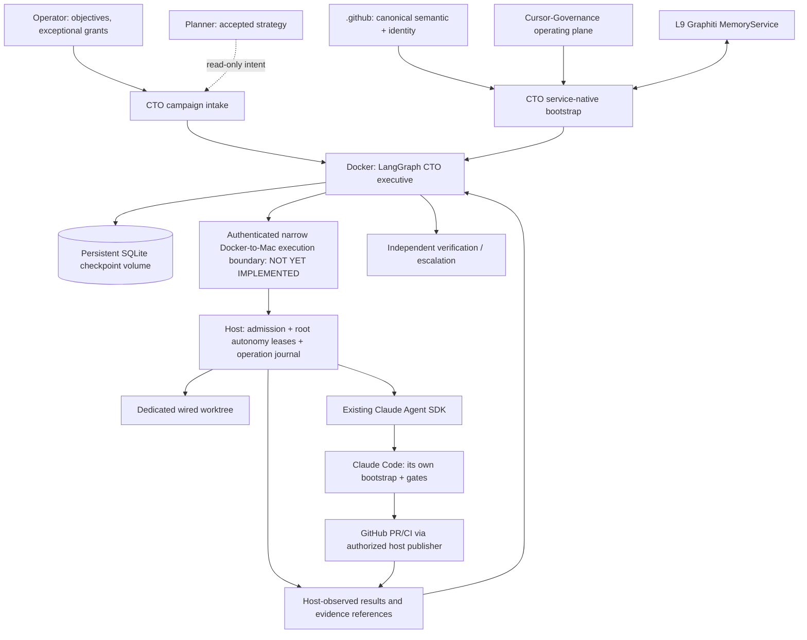
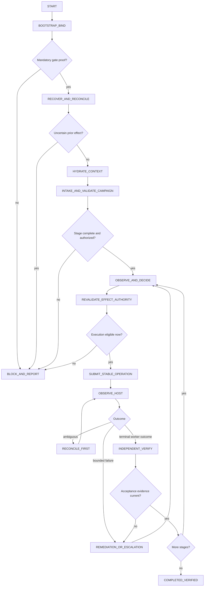
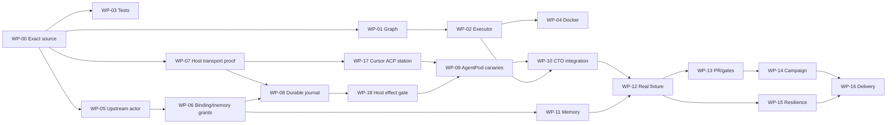

# L9 CTO | Master Developer Architecture & Build Specification v1.1

**CTO-DEV-PACK-001 / 1.1** | 2026-10-14 | OPERATOR-LOCKED DESIGN / NO EXECUTION AUTHORITY

Preserves original source annexes. Includes newly locked AgentPod, Authority Resolver and root Autonomy decisions and explicit missing proof requests. Local integrity validation is not admission or running proof.


---

> Source pack section: `README.md`

# v1.1 | Authority + AgentPod decision lock (2026-10-14)

**LOCKED as design:** Source repository remains `Quantum-L9/Cursor-Governance` (no new CTO repository). Mac host transport is **AgentPod Hub MCP → enrolled macOS `apn` node → authorized runtime station**. Preferred workers are Cursor CLI **ACP** (needs new AgentPod descriptor/proof) and Claude Code (existing AgentPod harness, L9 project-policy equivalence must be proven). `apn` is a local node daemon, **not** the CTO client. An enrolled machine credential is **not** CTO authority. For agent automation use an appropriately scoped Hub agent principal/MCP entrypoint. No privileged generic AgentPod terminal or broad file-write capability for CTO.

**LOCKED as authority division:** `l9-authority-resolver` resolves current applicable `.github` semantics and immutable coordinates; `Cursor-Governance/autonomy/runtime/` with `AdapterOrchestrator` is the **single existing enforcement owner** for campaign leases, roles, capability decisions, claims, receipt records and human-protected effects; AgentPod is transport, not L9 authorization. The CTO is a coordinator, not a role with free-standing code-write/merge rights. Workers obtain separate action-specific leases and native code contracts. The host MUST independently verify effective authorization at effect time. No new CTO policy ledger, scheduler, shadow publisher, runtime grant or repository.

**STILL NOT PROVEN:** canonical CTO actor/surface admission, producer-validated identity projection/resolution receipt, operating binding, AgentPod principal/MCP grants, native Cursor station descriptor, ACP hook conformance, APN host-side L9 gateway/revocation mediation, durable operation journal and replay safety, OS identity isolation, actual Mac canaries, memory principal and independent completion. All live effect gates remain blocked until demonstrated. See `docs/12_RISK_UNKNOWN_AND_DECISION_REGISTER.md` and `machine/decision_register.yaml`.

**Version precedence:** This v1.1 statement plus revised chapters supersedes *only* earlier generic-host-transport and SDK-only default assumptions. Original source annexes remain byte-identical and historical. F1 remains mock-only, with the same five admitted prospective files. No real execution or upstream mutation is granted by this developer pack.

# L9 CTO | Architecture & Build Developer Pack

**Pack:** CTO-DEV-PACK-001 · **Date:** 2026-10-14 · **Edition:** 1.1 (decision-lock update) · **Disposition:** DEVELOPMENT SPECIFICATION, NOT AN EXECUTION GRANT

**Mission:** Build a functioning standalone L9 technical executive that conducts routine engineering campaigns on the existing Cursor-Governance control plane. The CTO decides, delegates, supervises, reconciles and verifies. It does not impersonate actors, duplicate the control plane, mint its own permissions or self-certify success.

## Read this first

1. `docs/00_EXECUTIVE_CONTRACT.md` for operator intent, frozen decisions, non-goals, operational definition of done.
2. `docs/01_SOURCE_AUTHORITY_AND_FACTS.md` for source revisions, provenance and what is **not proven**.
3. `docs/02_SYSTEM_ARCHITECTURE.md` for trust boundaries, components, flows and authority ownership.
4. `docs/03_BOOTSTRAP_AND_READINESS.md` for CTO-BOOTSTRAP-001 and CTO-READY-001, their deterministic acceptance gates and revalidation.
5. `docs/04_CAMPAIGN_AND_STATE_MACHINE.md` + `docs/05_HOST_WORKER_PORT_AND_EFFECTS.md` for operational behavior, AgentPod-selected host transport, exact failure semantics, and unfinished host enforcement.
6. `docs/06_MEMORY_SECURITY_AND_PERMISSIONS.md` for memory, secrets, host isolation and prohibited actions.
7. `docs/07_LOCKED_FILETREE.md` for REUSE / EXTEND / NEW / CONDITIONAL / DEFER dispositions and justification per file.
8. `docs/08_WORK_PACKAGES_AND_DEPENDENCIES.md` and `machine/work_items.json` for granular implementation and parallel work admission.
9. `docs/09_ACCEPTANCE_AND_NEGATIVE_TESTS.md` and `machine/acceptance_tests.json` for testable GO / NO-GO.
10. `docs/10_OPERATOR_RUNBOOK.md`, `docs/11_REFERENCE_CAMPAIGN.md` and `docs/12_RISK_UNKNOWN_AND_DECISION_REGISTER.md` for deployment, first real workload and unknown ownership.
11. `handoffs/CLAUDE_CODE_BOUND_DELEGATION.md` for an implementation-ready contract with **no automatic permission to write, publish, merge or deploy**.
12. `docs/13_TRACEABILITY_AND_COVERAGE.md` for claim-to-source and claim-to-test closure.

`CTO_MASTER_SPEC.md` is a single-file combined rendering of the developer documents. `sources/` contains the exact available original design/recon/filetree artifacts. `machine/` is the reviewable, structured projection of the same proposed implementation plan, not an admitted upstream L9 semantic schema. `validation/` contains local consistency reports, digests, and limitations.

## Pinned inspected baselines

- `Quantum-L9/.github` `d4397e53f8f4c23458a80f87db9552463ad9e26f`
- `Quantum-L9/Cursor-Governance` `4cc0d7dc858021bc8e2a95a904e2945fd3d3acba` (original historical recon); **later reviewed main** `0bb60d78f8bdc22d09bd8464830cdfa62d61d0ed`
- `Quantum-L9/l9-graphiti-memory` `441b741e31a7bb5a57849e5b49b97465b1c7ee58`

The initial three were current `main` heads when independently rechecked during v1.0 creation. v1.1 separately rechecked the revised source seams; source history is not rewritten. **No Mac runtime, live Docker/host bridge, model invocation, signed canonical projection, or end-to-end code execution was proved.** The file tree's content is a design commitment for later delegated implementation, not evidence that its new files exist.

## Non-negotiable stop conditions

- A missing canonical CTO actor/surface or verified identity assertion stops consequential CTO operation.
- No real coding worker launch until an independently enforceable permission boundary, worker adapter and durable operation journal have been verified.
- A completed LangGraph node or worker-reported `success` is not independent evidence that an external effect occurred or passed acceptance.
- Merge authority requires a live human-issued exact-PR/head grant. The CTO and its worker must not issue one.
- No Program Execution dependency, Igorbot/OpenClaw dependency, parallel publisher, second long-term memory, general worker scheduler or general control plane.
- Any authority, transport or new schema requiring upstream admission must be processed by its owning authority outside this implementation pack.

## Assurance language

- **DESIGNED**: represented in this pack; not installed.
- **SOURCE-OBSERVED**: inspected at the pinned exact repository revision; not runtime-proven.
- **PROVED IN TEST**: actual recorded execution on an exact implementation commit and environment.
- **LIVE-PROVED**: actual host/worker effect plus independently observed result.
- **ADMITTED**: separately authorized by the applicable canonical/effect owner.

Never translate DESIGNED or SOURCE-OBSERVED into READY, LIVE-PROVED or ADMITTED.

## Status and source limitations

The available source is the attached CTO design (October 13), appended October 14 reconnaissance/design conversation document, source-inspected recon and the explicitly locked filetree plus the visible user decisions in this chat. A complete independently exported chronological original conversation is **not** available, nor are the Branch Consolidation playbook's referenced three native contract directories. Architectural semantic expression coverage therefore remains **partial**, and the pack makes **no claim of independent original-chat completeness or canonical semantic compilation**.


---

> Source pack section: `docs/00_EXECUTIVE_CONTRACT.md`

# 00 | Mission, frozen design decisions and delivery contract

## 0.1 Operator intent

The operator delegates a *technical outcome*, not a sequence of prompts to manually shuttle between tools. The CTO assumes the routine behind-the-keyboard technical executive role: inspect, choose, assign, monitor, correct, remember and verify. It may autonomously advance only those operations justified by actual delegated authority. Human-only decisions remain with their actual owners. A useful CTO reduces human relays rather than hiding them behind pseudo-automation.

Success is **one real, reproducibly accepted campaign**, interrupted and recovered without duplicate consequential operations, operated through current Cursor-Governance tools, not a dashboard showing optimistic green lights.

## 0.2 Decision record and status

| ID | Architectural commitment | Status and source basis |
|---|---|---|
| CTO-D001 | Standalone Python technical executive performing routine engineering operations | CONVERGED, original charter |
| CTO-D002 | Initial Mac Docker Desktop runtime, inside Cursor-Governance repo | LOCKED starting realization, design + operator confirmation |
| CTO-D003 | Independent of Igorbot and OpenClaw | LOCKED, user correction and original charter |
| CTO-D004 | `.github` owns canonical semantics and identity, no local substitute | LOCKED, confirmed source registry |
| CTO-D005 | Python + LangGraph for executive state and decision flow | LOCKED, operator acceptance |
| CTO-D006 | Reuse existing Cursor-Governance root autonomy capabilities, actual Claude SDK launcher, and native coding-agent contracts | LOCKED, pinned recon |
| CTO-D007 | Reuse `l9-graphiti-memory` for long-term private/shared memory under its own authorization | LOCKED, pinned memory binding |
| CTO-D008 | Distinct CTO actor and service surface, bootstrap derives verified upstream binding; no impersonation | LOCKED requirement; upstream *registration* NOT ADMITTED |
| CTO-D009 | Cursor IDE, Claude SessionStart and CTO service boot are different activation paths consuming the same governance | **CTO-BOOTSTRAP-001 LOCKED**, direct operator agreement |
| CTO-D010 | No READY from container health or memory alone; prove identity, delegation, worker interface, recovery | **CTO-READY-001** proposed acceptance realization of directly accepted readiness concern; no runtime proof |
| CTO-D011 | One active campaign + one delegated worker for the first real slice | LOCKED first-stage limit |
| CTO-D012 | Stable operation ID, host-observed effect journal, restart reconciliation and independent acceptance | LOCKED invariant |
| CTO-D013 | Merge and other protected grants remain independently human-authorized | LOCKED; current merge gates inspected |
| CTO-D014 | Fold routine operational coordination of CoS/PE/WorkState into CTO without inheriting retired Program Execution runtime | LOCKED intent; exact migration and fencing require source evidence |
| CTO-D015 | Branch Consolidation reference workload | SELECTED REFERENCE; not yet a runnable pack because native contract directories are missing |
| CTO-D016 | No new file unless an existing owner cannot lawfully satisfy the obligation | LOCKED implementation discipline |
| CTO-D017 | One bounded source recon → source-grounded filetree → coding | LOCKED operator sequencing, satisfied through these source documents |
| CTO-D018 | CO-Pilot: GAR architectural envelope → bounded Claude Code implementation → independent review and actual proofs | LOCKED development discipline |

**Do not misread the table:** A locked *requirement* can still depend on future canonical admission and live proof. CTO-READY-001 is the implementation-oriented gate design presented after user raised the false-READY danger; it is not a claim that `.github` admitted a new canonical contract.

### 0.2a Subsequent explicit operator locks, 2026-10-14

| ID | New locked decision | What it does **not** prove |
|---|---|---|
| CTO-D019 | **AgentPod selected** for Mac host control: CTO → AgentPod scoped agent MCP → enrolled APN Mac node → guarded Cursor ACP / Claude worker | A working host station, protocol bridge, local installation, or enforceable dispatch grant |
| CTO-D020 | **Authority Resolver + existing root Autonomy Runtime** are the authority-resolution and execution-authorization owners, respectively | Canonical CTO admission, live issuer grants or runtime integration |
| CTO-D021 | CTO coordinates and requests; existing action-specific `coordinator`/worker role and root lease/capability rules enforce each action; AgentPod does not grant L9 policy | Permission to act as a human, run host terminal unrestricted, or self-authorize a worker |
| CTO-D022 | **Cursor ACP is the selected Cursor worker interface**; it controls Cursor CLI agent sessions, not an already-open IDE session; Claude supported through AgentPod harness, with existing SDK still available for bounded native equivalence | Cursor is already a built-in AgentPod station, or project hooks behave identically |
| CTO-D023 | **No new CTO repository**; work stays in Cursor-Governance, with separately owner-authorized upstream identity and any AgentPod adapter change | Authority to write any of these repositories |
| CTO-D024 | Root autonomy authorization is **host re-enforced**, deny-by-default; durable host journal and independent verification cannot be replaced by AgentPod transport success | Existing JSON-line bridge is a secured host API or that ACP permissions enforce L9 grants |

The operator locked these architecture choices in the visible follow-up. The engineering proofs remain open in `docs/12`. A new AgentPod harness adapter requires its **own** upstream owner/grant, not a silent writable-scope expansion.

## 0.3 Single-line system promise

Given an authorized, correctly scoped engineering campaign and current governing authority, the CTO can determine the next authorized technical action, delegate it through existing protected execution paths, observe the actual result, obtain appropriate independent verification, persist continuity and recover safely after process or host interruption.

## 0.4 Architecture boundaries

**Owned by CTO:** executive choice, campaign intake/continuation, sequencing based on accepted dependencies, contextual hydration, operation-id correlation, review/escalation decisions, cross-operation convergence and accurate operator reporting.

**Not owned by CTO:** canonical semantic definitions; actor/surface admission; provider choice as canonical semantics; GitHub permissions or grants; memory storage, shared-memory promotion rules; native code implementation logic; Claude permissions/hooks; global execution lease protocol; publication/merge semantics; independent reviewer authority; deployment/host secret issuance.

## 0.5 Non-goals, explicitly excluded in initial tranche

No generic control plane, second dispatcher or scheduler, full PE resurrection, Telegram or elaborate UI, forced DeepSeek model binding, five-way parallelism, LangSmith platform dependency, database migration beyond existing SQLite checkpoint support, always-on cloud host, direct Docker mount of host home or Docker socket, automatic merges, architecture refreezing during code, autonomy self-grants or automatic semantic compiler invocation to manufacture canonical profiles.

## 0.6 Success rubric

1. Native service startup under Docker produces explicit per-capability evidence with missing mandatory components blocked.
2. Canonical identity, current binding and actual standing delegation are **validated**, not guessed.
3. CTO consumes a bounded complete campaign and produces a lawful next-action choice.
4. Mock path completes with honest `MOCK_ONLY` and strict refusal of real mutation.
5. Real path (later) submits a native coding contract through a *trusted host authority boundary*, invokes actual Claude with its own bootstrap and observes outcome.
6. Resume after intentional worker ACK loss, host interruption and replay does not duplicate external effects.
7. Host, Git and artifact acceptance evidence is attributed to the exact source/target revision, not copied from worker prose.
8. Memory permits CTO-scoped knowledge as authorized, denies unauthorized principal cross-access, and is not misused as an effect journal.
9. Protected publication/merge never inherits authority from CI success or the CTO's self-report.
10. First operator campaign demonstrates measurable reduction of routine human relays and zero false-positive completion claims.

## 0.7 Explicit non-authorization

This pack is an engineering specification and proposed implementation handoff. It does **not** grant code mutation, external repository access, push, merge, deployment, secret access, new actor admission, new semantic profile or the creation of a protected workflow. A downstream coding session must bind its own exact current targets, write permissions, frozen base and validated commands.


---

> Source pack section: `docs/01_SOURCE_AUTHORITY_AND_FACTS.md`

# 01 | Revision-bound evidence, authority ownership and provenance

## 1.1 Baseline and method

Exact `main` heads observed through the GitHub connector on 2026-10-14:

| Repository | Exact SHA | Inspected responsibility |
|---|---|---|
| `Quantum-L9/.github` | `d4397e53f8f4c23458a80f87db9552463ad9e26f` | Identity model, actor/surface registries, source and projection catalogs |
| `Quantum-L9/Cursor-Governance` | `4cc0d7dc858021bc8e2a95a904e2945fd3d3acba` | Runtime mechanics, worker adapter, native governance, memory and publisher |
| `Quantum-L9/l9-graphiti-memory` | `441b741e31a7bb5a57849e5b49b97465b1c7ee58` | MemorySDK, MemoryService, signed agent identity, MCP server |

**Important qualification:** This is directly observed source from exact GitHub refs. It is **not** a producer-validated AuthorityResolution receipt, verified canonical compiler artifact, signed projection proof, live Mac checkout, or runtime PASS. A later code implementer must first rebase source reality to its exact contemporaneous head without silently reinterpreting these design commitments.

## 1.2 Source findings and operational implications

| Finding | Source coordinate | Observation | Consequence |
|---|---|---|---|
| A01 | `.github/semantics/actor_registry.yaml` | No `l-cto` actor entry at pinned head; identity registry grants no permissions | Upstream actor decision is prerequisite for live CTO actions |
| A02 | `.github/semantics/surface_registry.yaml` | No CTO Docker service surface entry; surface registration does not bind a worker/actor | Resolve canonical service surface at correct owner; never hardcode |
| A03 | `.github/semantics/identity_model.yaml` | Product, release, runtime, actor, surface distinct; identity assertion does not grant new authority | CTO bootstrap is a consumer of identity proof, separate from delegation |
| A04 | `Cursor-Governance/environment/agents/agent_registry.yaml` | No active CTO operating binding; role grant composition belongs to operating plane | Do not promote `l-cto` from local memory placeholder |
| A05 | `ops/memory/agent_identity.py` | `l-cto` is explicitly labeled reserved/not wired | Reference name is not identity admission |
| A06 | `environment/agents/adapters/claude-agent-sdk/l9_agent.py` | Real `ClaudeSDKClient` path, project settings, turn/budget limits, structured ResultMessage report | Reuse worker launcher but bridge/replay semantics not yet present |
| A07 | `environment/agents/adapters/claude-agent-sdk/validate_agent_sdk_env.py` | Forbids policy shadowing; checks SDK pin, settings and import availability | CTO must not pass independent tool allowlists or bypass project settings |
| A08 | `autonomy/adapters/orchestrator.py` + `autonomy/adapters/bridge.py` | Produces leases and deployment descriptors but does not prove Claude OS process spawn | A deployment descriptor is not a worker execution receipt |
| A09 | `autonomy/runtime/store.py` | SQLite WAL, explicit transactions; campaigns, actions, leases, claims, artifacts, receipts, decisions | Candidate for host operation journal after exact ownership check; not automatically an RPC host |
| A10 | `autonomy/adapters/cursor/host_bridge.py` | Example of adapter extension data inside existing root autonomy DB | Reuse precedent, not Cursor-only transport implementation |
| A11 | `workflows/dags/_runtime/durable_checkpointer.py` | Workspace `.l9/langgraph/<dag>.sqlite` backed by SqliteSaver | Reuse checkpoint mechanics via persistent Docker volume |
| A12 | `tests/workflows/test_langgraph_durable_resume.py` | Contains two-instance checkpoint restore fixture | Existing *test source* shows intended proof, but no test was executed here |
| A13 | `skills/l9-coding-agent/contracts/EXECUTION_CONTRACT.yaml` | Existing bounded task contract and scope/authority fields | Do not create a CTO coding contract schema |
| A14 | `skills/l9-coding-agent/scripts/validate_execution_contract.py` | Checks structural minimum only | A valid JSON shape is not an effect grant |
| A15 | `ops/config/memory-binding.json` | Pins l9-graphite-memory 2.6.0 at immutable memory revision | Reuse existing package, runtime binding and namespace policy |
| A16 | `ops/memory/run_memory_mcp.sh`, `agent_assertion.py`, `materialize_agent_authority.py` | Signed per-principal memory door and active-binding requirement | Explicit CTO principal and authorized namespaces needed |
| A17 | `.claude/settings.json`, `.mcp.json`, Claude SessionStart shell | Worker governance is project-owned and host/session activated | CTO service cannot simply invoke Claude bootstrap as its own |
| A18 | `ops/scripts/agent_worktree_start.sh` | Dedicated wired agent worktree with pinned fetched base and task metadata | Use existing host-side isolated worktree protocol |
| A19 | `ops/scripts/open_pr_after_gate.sh`, `make pr` machinery | Existing guarded publication path | No second publisher or raw GitHub write shortcut |
| A20 | `ops/autonomy/authorize_merge.py`, `stack_safe_merge.py`, `merge_gate.py` | Human exact-PR/head grant; grant terminal challenge has same-account isolation limitation | CTO/worker never hold grant issuer privileges; separate host accounts/trust |
| A21 | `AGENTS.md` Oct 6–7 amendments | Program Execution is eviction target; surviving runtime cannot import it | No PE or legacy program campaign dependency |
| A22 | `ops/scripts/emit_claude_readiness.py`, `write_runtime_readiness_receipt.py` | Existing read-time status, source SHA and age-sensitive readiness patterns | Reuse predicates/semantics where applicable; no parallel validator |
| A23 | `environment/agents/deployment/receipts.py` | Digest/source-manifest validation is Cursor deployment-specific | Do not label Cursor receipt as CTO admission |
| A24 | `autonomy/validation/doctor.py` | CLI explicitly disabled; directs callers to `AdapterConformance.run()` | Don't put a disabled doctor command in build plan |
| A25 | `pyproject.toml` | Python >= 3.12, LangGraph/sqlite saver already dependency; Claude SDK pinned optional extra | Reuse locked Python stack, keep worker SDK host-only |
| A26 | `commands/lcto.md` | Legacy conversation mode, no durable worker control path | Do not pass off persona command as CTO implementation |

## 1.3 Immutable source URLs

Replace `{CG}` with `https://github.com/Quantum-L9/Cursor-Governance/blob/4cc0d7dc858021bc8e2a95a904e2945fd3d3acba` and `{ORG}` with `https://github.com/Quantum-L9/.github/blob/d4397e53f8f4c23458a80f87db9552463ad9e26f`.

Key files: `{ORG}/semantics/{identity_model,actor_registry,surface_registry,canonical_sources,projection_profiles}.yaml`; `{CG}/environment/agents/adapters/claude-agent-sdk/{l9_agent.py,validate_agent_sdk_env.py}`; `{CG}/autonomy/runtime/{engine,store,claims,leases}.py`; `{CG}/autonomy/adapters/{orchestrator,bridge}.py`; `{CG}/workflows/dags/_runtime/durable_checkpointer.py`; `{CG}/ops/memory/{runtime_binding,agent_identity,materialize_agent_authority}.py`; `{CG}/skills/l9-coding-agent/contracts/EXECUTION_CONTRACT.yaml`.

Direct immutable URL example: https://github.com/Quantum-L9/Cursor-Governance/blob/4cc0d7dc858021bc8e2a95a904e2945fd3d3acba/environment/agents/adapters/claude-agent-sdk/l9_agent.py

## 1.4 Required stage-specific rechecks

At implementation intake: resolve upstream owner, local repository HEAD, correct base branch, PRs and a clean isolated worktree; re-read each source file being edited; validate that locked design remains realizable. At integration: verify Mac-installed SDK interpreter, actual trust settings, a signed and scope-bound CTO actor, real process isolation and available memory. At acceptance: capture actual environment, target commit, host operation journal, independent GitHub/CI evidence and restart receipts.

A changed source revision invalidates affected source-derived assumptions only; it does not authorize spontaneous architecture revision.

## 1.5 Fidelity limits

Original donor files are supplied intact in `sources/`; an independent, complete original chat transcript was not available. `Cto!!!(1).md` includes speculative sketches and mock-only code, not installed modules. The Branch Consolidation reference references contract directories not attached here. Do not certify full original conversation coverage, reviewed missing contract contents or target-specific production readiness. The local machine files are an implementation projection with documented statuses, never a fabricated canonical L9 ProductManifest or WorkflowSpec.

## v1.1 | Additional exact source inspections and external support

Earlier source baselines in this chapter are immutable **historical reconnaissance**, not evidence that a host is running. The following later inspected sources inform CTO-D019 through CTO-D024:

| Owner / immutable revision | File or provider | Source-proven fact |
|---|---|---|
| `.github@d4397e53f8f4c23458a80f87db9552463ad9e26f` | `semantics/actor_registry.yaml`, `semantics/surface_registry.yaml`, `semantics/identity_model.yaml` | Neither registry has a CTO actor/surface; identity is not authorization |
| `Cursor-Governance@0bb60d78f8bdc22d09bd8464830cdfa62d61d0ed` | `autonomy/runtime/{engine.py,capability_gateway.py,store.py,leases.py,receipts.py}` | Campaign scope, leases, claims, receipts and per-capability denial checks exist as source code |
| Same CG revision | `autonomy/adapters/{orchestrator.py,conformance.py,bridge.py,protocol.py}` | Existing adapter request, grant acknowledgment, tool mediation, receipt and conformant peer registry mechanisms; bridge is a JSON-line *stdin* adapter, not a secure remote API |
| Same CG revision | `autonomy/policies/{role-capabilities.json,adapter-requirements.json}` | `coordinator` is read/schedule-only; `executor`/`remediator` have bounded mutations; `pr.merge`, `pr.admin_merge`, `git.force_push` are globally forbidden by root policy; adapter must enforce mediation |
| Same CG revision | `environment/agents/{agent_registry.yaml,PEER_RUNTIME_BINDINGS.yaml}` | CTO is not bound; peers depend on root-autonomy-control-plane; memory role bindings are a separate concern |
| `SuperJackfruitLabs/agentpod@e647ab22722819a23329e40152ff442977046705` | `apps/node-agent/cmd/agentpod-node/registry.go` | Node-agent registers Claude Code, Codex and others; **no Cursor descriptor appears** in this exact registry |
| Same AgentPod revision | `docs/OPERATING.md` | Node `apn` and fleet/operator `fleet` are distinct; agent principals use Hub MCP; native station terminal is an **unconfined host-user shell**, and must not be exposed as CTO fallback |
| Official Cursor CLI documentation (external live page, date observed 2026-10-14) | https://prod.cursor.com/docs/cli/acp | `agent acp` exposes stdio JSON-RPC; sessions, updates, permissions, cancel. This is a supported Cursor CLI interface, **not** proof of AgentPod support or an IDE-chat control API |

No live Mac, Hub, APN, Cursor CLI, SDK canary, signed projection receipt, principal/grants, delegated authority, operation journal or production acceptance was observed. Source links remain revision-specific. This pack does not claim a produced/validated `l9.authority-resolution/v1` receipt: only bounded source inspection and an explicitly selected resolver integration approach are established.


---

> Source pack section: `docs/02_SYSTEM_ARCHITECTURE.md`

# 02 | Complete target system architecture and ownership

## 2.1 Logical and physical tiers



**Physical boundary 1: Docker executive.** Runs CTO Python/LangGraph; uses a restricted mounted checkpoint volume and strictly scoped, independently authenticated external calls. No Docker daemon socket, Mac home, grant issuer account, repo-write mount, operator credential or Claude worker secret in the container.

**Physical boundary 2: Mac worker host.** Owns code checkout, the actual Claude SDK process, target worktrees, permissions/hooks, GitHub credentials and journal of external operations. CTO requests are untrusted until host verifies them independently. The host does not infer authority from model-authored prose or an arbitrary env var.

**Physical boundary 3: Canonical and memory upstream.** `.github` defines semantics and admits identity; Cursor-Governance consumes canonical projections and owns execution governance; MemoryService enforces memory principal/namespace grants.

## 2.2 Actor identity, runtime identity and trust model

ProductIdentity (if applicable), ReleaseIdentity, RuntimeIdentity, ActorIdentity and SurfaceIdentity are separate canonical dimensions. Distinct adapter/provider identifiers and governance profiles are not identities. CTO's actor/surface are unresolved in the current upstream registers. CTO may not borrow `cursor`, `claude-code`, `human` or merely set `L9_MEMORY_AGENT_ID=l-cto` to assert itself.

**Delegation is separate from identity.** A valid CTO actor assertion tells the host *who* requests a task, not *whether* that actor may modify the named target, execute this worker, create a PR or merge anything. Proof must be scoped to operation, repository, revision, restrictions, grant issuer, expiry and effect class.

## 2.3 Executive responsibilities

- Accept campaigns and reject incomplete/ambiguous ones without inventing requirements.
- Observe actual current state from the relevant owner. Fresh source SHA and target HEAD matter.
- Choose next authorized stage based on predecessor evidence and actual delegated permissions.
- Supply the native coding execution contract and worker inputs without mutating its locked schema.
- Supervise one worker, manage lease lifecycle and inspect host truth. Remote worker success is never promoted directly into verified business outcome.
- Drive bounded same-scope remediation on evidence-backed failure; preserve unrecoverable and unauthorized outcomes as escalation.
- Keep operational continuity in LangGraph; store relevant durable knowledge in MemoryService under actual principal grants, not in checkpoint as global fact.
- Report operator-facing `READY_FOR_READ`, `EXECUTION_BLOCKED`, `EXECUTION_ELIGIBLE`, `RUNNING`, `VERIFY_PENDING`, `MERGE_PENDING`, `COMPLETED_VERIFIED` as *explanatory presentation labels*; do not claim these are new globally admitted L9 enum values.

## 2.4 Ownership and single-writer matrix

| Concern | Authoritative owner | CTO operation | Must not do |
|---|---|---|---|
| Global identity and invariants | `.github` canonical source + qualified admission producer | Consume exact verified projection/assertion | Edit/locally shadow law |
| Strategy and objectives | Planner / operator | Consume accepted priorities | Change strategic plan |
| Architecture | GAR / proper semantic authority | Consume frozen architecture, raise contradictions | Reopen freeze in coding stage |
| Campaign coordination | CTO | Operate one active campaign | Concurrent duplicate commander |
| Global action leases and claims | Root `autonomy/` | Request, verify, reconcile | Second leases DB or arbitrary claim generator |
| Worker runtime | Claude SDK/host + Claude Code adapter | Delegate bounded task, observe | Duplicate code execution engine |
| Worker governance | Project `CLAUDE.md` / `.claude/settings.json` / actual hooks | Require correct project bootstrap and installed SDK | Inject shadow allowlists/hook policy |
| Git worktrees and publication | Existing host scripts, existing `make pr` | Call only through authorized host boundaries | Raw push bypass, parallel publisher |
| Merge grants | Human + existing merge gate | Report pending exact target | Mint or forge grant, auto-merge |
| Memory | MemoryService | Context, scoped durable lessons | Store shared facts without authorization |
| Workflow continuation | LangGraph checkpoint | Resume same campaign thread | Treat checkpoint as effect journal |
| External effect truth | Host journal, GitHub, CI, independent assessor | Observe and reconcile | Trust worker prose |
| Secrets | Existing host/Infisical and effect-owner setup | Reference permitted capabilities | Copy credentials into container/prompt |

## 2.5 Workflow graph and edges



Each decision node consumes typed evidence and returns state updates. Graph builder does not compile; executor alone binds the existing durable checkpointer. One stable `thread_id` per campaign. Recovery uses `invoke(None, config)` rather than replaying a fresh start for an already checkpointed thread.

## 2.6 Command and data interfaces (conceptual, not new APIs)

**Inbound:** operator objective, campaign pack reference plus exact SHA/digest, frozen acceptance criteria, explicit permit/grant references, target repository/ref, allowed read/write scope, forbidden actions, explicit resource ceilings.

**Internal:** immutable canonical binding and provenance, bounded campaign state, one or more read-only observations, next-action decision, operation ID/fingerprint, pending verification and risk register.

**Host egress:** `submit(operation)`, `observe(operation_id)`, optionally authorized `cancel(operation_id)`; details must bind to existing owner contracts and are not presented as a new canonical L9 schema.

**Memory:** existing read, hydrate, scoped write, governed write/phase-lock and close through admitted principals; not a worker effect journal.

**Evidence:** host observation, exact worker process metadata, artifact digest/target HEAD, current CI/review receipts, independent acceptance when required. Evidence is append-only by logical identity; corrections do not erase prior contradictory observations.

## 2.7 Deployment topology and failure domains

Docker restart should preserve persisted `.l9/langgraph` checkpoint files and restore *ongoing* campaign identity. Container loss cannot kill a host worker's independent truth; on resume CTO must query host first. Mac shutdown may stop both; on reboot replay begins from host operation journal and GitHub truth, not client retries. Unavailable upstream identity/projections stops effect admission; unavailable memory blocks campaigns only when that operation requires context or a governed memory write. Network split produces `UNKNOWN`, never inferred effect failure.

## 2.8 Initial vs later capabilities

**Initial:** local Docker, one executive, one campaign, one worker, read-only canary then one fully governed code task, SQLite checkpoint, private/shared memory if independently bound, explicit status output.

**Later after independent proof:** parallel claims, multiple worker roles, hosted availability, richer ingress, reasoning-model provider optimization, remote observer enhancements, performance dashboards, additional memory semantics only from proper owners.

## v1.1 | Selected execution plane and owner chain

```text
Quantum-L9/.github [canonical identity and law; no effect grants]
    |  existing l9-authority-resolver, verified immutable authority resolution
    v
Cursor-Governance CTO / LangGraph [executive coordinator only]
    | asks existing root AutonomyRuntime/AdapterOrchestrator for lease + permission
    v
Cursor-Governance root Autonomy [campaign, action, claims, capability, receipts]
    | independently verifiable action/grant; NO raw shell
    v
AgentPod Hub [scoped agent principal + MCP: transport/access broker]
    | outbound WSS, enrolled APN macOS node
    v
Host-side L9 effect gate [must recheck exact operation and current grant]
    | read-only or granted isolated worktree, durable op record
    +--> Cursor CLI via ACP [needs AgentPod descriptor and current hooks proof]
    `--> Claude Code AgentPod station [supported descriptor, L9 hook parity unproved]
    | effect observation + independent evidence
    v
Root receipts/checkpoints [reconciliation and acceptance, no self-certification]
```

**No new repository.** AgentPod's own upstream project remains an externally owned dependency; a needed Cursor descriptor change requires separate upstream authority and write grant. AgentPod's role is **transport/runtime management only**, not a replacement for L9's semantic law, permission decisions, separate worker role, native code contract, or protected publication. CTO LangGraph checkpoints record executive state, not remote operation completion. No direct relationship exists between AgentPod `apn` machine enrollment and CTO actor admission.


---

> Source pack section: `docs/03_BOOTSTRAP_AND_READINESS.md`

# 03 | Service-native bootstrap and evidence-based readiness

## 3.1 Accepted bootstrap design (CTO-BOOTSTRAP-001)

**One governance system, three activation mechanisms.** Cursor uses IDE `sessionStart`; Claude Code uses `SessionStart` + project settings; CTO runs deterministic service-start and restart validation that consumes upstream authority and the same operating-plane controls. CTO does not execute Cursor or Claude hooks as its own bootstrap. When it dispatches Claude, the launched Claude process still independently activates its own project hook/settings chain and retains its separate actor identity.

The service may be **alive and inspectable** even when no consequential execution is allowed. Do not conflate *liveness*, *dependency health*, *identity resolution*, *capability evidence* and *authorization to perform a particular effect*.

## 3.2 Startup deterministic sequence

| Step | Input/proof | Owner | On missing or invalid |
|---|---|---|---|
| B00 Trusted authority locator | Independently provisioned upstream identity and pinned source verification basis | Deployment plus canonical authority owner | Expose `AUTHORITY_UNTRUSTED`, stop consequential dispatch |
| B01 Freeze canonical snapshot | One immutable `.github` SHA, declared source closure, no mixed moving refs | Source authority/projection consumer | `SOURCE_REVISION_UNKNOWN`, block dependent actions |
| B02 Qualified projection consumption | Applicable profile, source object digests, producer artifact and verifiable receipt | Semantic compiler/canonical profile owner | `PROJECTION_UNBOUND`; no local regeneration to bypass |
| B03 Resolve distinct identities | Product/release/runtime/actor/surface as applicable; CTO actor and service surface validated | Canonical identity resolver | `IDENTITY_NOT_ADMITTED` or `IDENTITY_UNVERIFIED`; refuse live actions |
| B04 Bind operating-plane grants | Active CTO binding and actual delegated scope, effective runtime profile, issuer/expiry | Cursor-Governance authorization owner | `DELEGATION_UNBOUND`; read-only diagnostics only |
| B05 Verify local image/config | Image source digest, Python pinned deps, no privilege mounts, checkpoint volume writable/durable | Runtime/deployment owner | `RUNTIME_UNAVAILABLE`; retain diagnostic output |
| B06 Bind memory principal | Package/contract pin, actual signed principal, namespaces and read/write grants | MemoryService / operating identity owner | `MEMORY_UNBOUND`; block memory-dependent work |
| B07 Recover checkpoint and effect state | Same thread ID; read host journal before any prior operation retry | LangGraph + host-effect owner | `RECOVERY_UNRESOLVED`; deny any potentially duplicate effect |
| B08 Verify host interface | Authenticated host endpoint, request binding, host-side effect scope, exact worker binary | Mac host owner | `HOST_UNREACHABLE`; deny real worker submission |
| B09 Read-only canary | Authorized, unique operation ID; observed process start/exit, journal and evidence | Host SDK + effect observer | `WORKER_UNPROVEN`; deny mutation |
| B10 Campaign admission | Complete native contract, exact repository SHA, allowed scope, current delegation and all prerequisites | CTO + existing gate owners | `CAMPAIGN_BLOCKED` or accurate missing evidence list |
| B11 Enter per-operation eligible mode | Every effect-specific requirement still true; no known unresolved identical action | Existing effect authorizer | Admit only the specified effect, no global authority |

No fixed CTO actor ID, new ProductKind, service provider, transport, or permission fields may be inferred from this sequence. These are **obligations**, not claims that the upstream owner already provides them.

## 3.3 Five core gate obligations (CTO-READY-001)

**G1 Identity:** verify accepted canonical CTO actor and service runtime surface, assertion authenticity, source/currentness and provenance. Local string `l-cto` alone fails.

**G2 Delegation:** verify a non-self-issued effective grant applicable to the exact repository, operation kind, executable, target SHA, file scope, worker, issuer and time window. If existing contract expresses a subset, consume it; do not add fields to a locked schema to cover an unknown.

**G3 Host worker:** demonstrate the host authenticates independent CTO requests, verifies native coding contract bytes/digest and worktree restrictions, launches an existing SDK worker, writes a durable operation acceptance record, and returns independently observable results. A working network socket or report file alone fails.

**G4 Recovery:** prove checkpoint preservation AND host effect journal correlation AND replay/idempotency of same operation ID across process death/lost ack. Distinct ids with same effects need policy-controlled reconciliation, not blind execution. Journal must preexist the consequential launch.

**G5 Memory:** prove signed CTO principal, MemoryService contract-compatible runtime, effective namespace grants and a real read/hydration against an authorized namespace. If memory is optional for the current operation, report degraded/unknown and withhold memory-dependent decisions; never substitute a different agent's principal.

For live delegated execution G1–G4 are mandatory. G5 is mandatory for operations consuming memory state or writing governed lessons. A campaign requiring memory cannot silently skip the dependency. Host-side mutation remains separately governed even if all five startup checks passed.

## 3.4 Evaluation semantics (not an invented canonical schema)

Describe each obligation as `PASS`, `FAIL`, `UNKNOWN` or `STALE` and attach evidence coordinate/revision/time. These are *reporting categories in this pack*, not new canonical enum members. Missing, contradictory, stale or unverifiable required proof means **not eligible**. `UNKNOWN` is not a warning that a caller may override. A mutable local success flag cannot supply provenance.

The CTO may publish a structured **readiness view** for operator inspection, but the actual host/effect gate must recompute or validate the underlying current evidence independently. CTO-readiness itself is *not* a grant and does not cause a bypass. `READY_FOR_READ` is allowed without worker eligibility.

## 3.5 Per-operation admission (mandatory after startup)

Before any `submit` with side effects:

1. Resolve the exact current target SHA and compare it with contract base and expected operation target. Reject stale or ambiguous targets.
2. Verify accepted frozen campaign step dependencies and that claimed scope does not overlap an active independent commander.
3. Verify current actor assertion and effective delegation, not merely presence of a cached bootstrap receipt.
4. Verify native coding contract structural validity with its owner and enforce semantic authority/permission at the real host boundary separately.
5. Verify host journal state for the identical operation ID; if accepted/running/terminal return observed current record, not another spawn.
6. Verify host worker account isolation and inability to write human grant-issuer data.
7. Reserve host operation record and root autonomy claims atomically as needed; process launch follows durable acceptance, not precedes it.
8. After completion, verify expected external effects with independent target providers before advancing acceptance.

**TOCTOU protection:** where GitHub SHA, grants, claims or worker health can change between check and effect, the host must validate at execution time and use effect API head checks/immutable input. CTO-side preflight alone does not secure the race.

## 3.6 Invalidation triggers

- Upstream canonical digest, current admitted profile or actor/surface status changes.
- Grant expires, revoked or scope changes; exact requested PR head moves.
- Worker process, SDK dependency, project hooks or host account changes.
- Worktree base, capability scopes, target ref or execution profile changes.
- Host journal reports conflicting digest for a known operation ID.
- Required MemoryService version, namespace authorization or principal changes.
- Checkpoint path changes, DB missing/corrupt, Mac restarts with unresolved effects.
- New independent reviewer finds invalid evidence or change breaches locked invariant.

Invalidate only affected evidence. Do not restart or recompile every component indiscriminately. Pending external outcomes must be reconciled before dependent operations resume.

## 3.7 Proof vector catalog

| ID | Input injection | Required outcome |
|---|---|---|
| BR-001 | Docker app launches, no authority pin | Service inspectable, live execution denied |
| BR-002 | Valid source pin, unknown CTO actor | No fallback to Cursor/Claude |
| BR-003 | Valid actor, no current delegation | Worker submit denied by host |
| BR-004 | Valid grant, hostile target repository/SHA | Deny before worktree creation |
| BR-005 | Transport reachable but host doesn't execute worker | No READY/VERIFIED claim |
| BR-006 | Signed CTO memory principal absent, memory health succeeds under Claude principal | CTO memory remains unbound |
| BR-007 | Valid initial bootstrap, grant revoked | Next protected action denied |
| BR-008 | SDK-installed but project governance files missing | Worker launch denied |
| BR-009 | Host returns `accepted`, no terminal record | Remain pending; no acceptance |
| BR-010 | Restart after checkpoint with host effect already committed | Observe/no second spawn |
| BR-011 | Stale successful readiness receipt | Revalidate; never elevate cached result |
| BR-012 | Actor-only identity mistaken for permission | Deny effect, report distinct missing delegation |

## 3.8 Implementation placement and acceptance

The CTO graph executor owns the composition and presentation of bootstrap readiness in `workflows/dags/cto/executor.py` and uses existing source-specific verifier readers. Existing `ops/scripts/emit_claude_readiness.py`, `write_runtime_readiness_receipt.py`, runtime-bound memory and adapter conformance are reference owners, not evidence the CTO has already passed. New CTO-domain negative tests belong in `tests/workflows/test_cto_runtime.py`; any owner-level regression sits next to the modified owner. Do not introduce `cto/readiness_schema.yaml` or `cto/permissions.py` unless source-grounded irreducibility requires it and a separate revision authorizes changing the locked filetree.

## v1.1 | CTO-ready gate integration, no second validator

- **Authority Resolver:** freeze current `.github` revision; resolve actor, surface, applicable source contracts and target-specific provenance. A skill's text or a local registry value is not a validated AuthorityResolution or a signed runtime assertion.
- **Root Autonomy Runtime:** verify campaign authorization, action readiness, role-policy ceiling, acknowledged active lease, operation mapping and scoped resource in `CapabilityGateway`. A coordinator may schedule/request but does not inherit workers' mutation capabilities.
- **AgentPod adapter:** require conformant peer/provider/surface binding, actual scoped Hub MCP agent principal, authenticated node station, and capability-specific worker route. `apn` machine identity is not a CTO actor grant; fleet/operator token is not the CTO's agent credential.
- **Host re-enforcement:** before any code/effect tool call, verify lease still valid, exact contract bytes/digest, target repo/base SHA, worker permission and host account isolation. No generic AgentPod Terminal or file-write capability available to the CTO. ACP `allow-once`/`allow-always` is NOT an L9 grant.
- **Recovery:** host-accepted operation ID bound durably before execution, observe-first on reconnect/restart, duplicate-id conflict detection, independent Git/CI/worktree evidence before VERIFIED.
- **Status:** provider online, MCP connected, APN enrolled, ACP process started, memory readable and Docker healthy are *component observations only*. Never independently imply live CTO execution READY.

Any missing required proof remains `BLOCKED` or `UNKNOWN` for the affected effect; F1 always reports `MOCK_ONLY` even with all fake adapter checks green. CTO-READY-001 is a *local design obligation*, not a newly minted global receipt schema.


---

> Source pack section: `docs/04_CAMPAIGN_AND_STATE_MACHINE.md`

# 04 | Campaign intake, LangGraph semantics and executive continuation

## 4.1 Input admission model

The first CTO receives **one campaign**, not arbitrary untrusted freeform agent instructions. Intake must resolve:

- Objective and operator-approved outcome, exact campaign identity, governing authority, source evidence and accepted architecture freeze.
- Repo targets with explicit *read vs write* classifications and exact baseline refs/digests.
- Ordered stage dependencies; proof owners; target-specific acceptance; protected-effect gates; timeout/cost ceilings; negative cases.
- Native execution-contract identity and byte digest for delegated coding work; specific verification obligations.
- Explicit excluded tasks, constraints and unresolved mandatory inputs.
- Existing grant/permit refs. A campaign pack, even if internally consistent, conveys **no authority by itself**.

Partial packs may be inspectable or planned but must not enter executable stages with missing material contracts. The reference Branch Consolidation pack is currently in this class until three native contract directories are supplied and validated.

## 4.2 State components and lifecycle

Use existing `StateGraph` and the `open_checkpointer()` owner. Keep graph state minimal and serializable; include stable campaign thread identity, current stage/action, source/target provenance, verified binding refs, one outstanding host operation ID, pending evidence links, known unknowns, remediation count and stop reason. **This list describes required information, not a new frozen canonical schema**; implementation may map to existing DTOs and must not invent upstream schema fields.

Suggested graph nodes, implemented only if not duplicating existing node responsibilities:

| Stage | Input | Deterministic side effect? | Success transition | Failure transition |
|---|---|---|---|---|
| `INTAKE` | campaign ref / user request | No | `BOOTSTRAP` | `BLOCKED` |
| `BOOTSTRAP` | exact sources / identity assertion / configuration | Read-only probes | `RECOVER` | `BLOCKED` |
| `RECOVER` | checkpoint, outstanding op ids | Read-only host observe | `HYDRATE` | `WAIT_RECONCILIATION` |
| `HYDRATE` | memory queries under bound principal | Read-only memory | `OBSERVE` | `BLOCKED` if mandatory; degraded if optional |
| `OBSERVE` | current target and stage evidence | Read-only repo/CI/host | `DECIDE` | `BLOCKED`/retry bounded probe |
| `DECIDE` | accepted plan and observed evidence | No effects; produces candidate action | `VALIDATE` | `ESCALATE` |
| `VALIDATE` | grants/claims/contract/source hash | Read-only verification | `SUBMIT` or `VERIFY` | `BLOCKED` |
| `SUBMIT` | stable operation ID + exact immutable inputs | Host effect submission | `RECONCILE` | `RECONCILE` (even on timeout) |
| `RECONCILE` | host journal, remote effect state | Read-only observation | `VERIFY` / `WAIT` | `BLOCKED_UNKNOWN` |
| `VERIFY` | independent artifact, CI, acceptance proof | Qualified assessor may act within permission | `ADVANCE` or `REMEDIATE` | `VERIFY_PENDING` |
| `REMEDIATE` | scoped findings, revision-bound guardrails | New authorized operation only | `VALIDATE` | `ESCALATE` |
| `ADVANCE` | accepted stage receipt | Checkpoint update | `OBSERVE` / `COMPLETE` | `BLOCKED` |
| `COMPLETE` | all stage receipts and no pending effects | No | terminal `COMPLETED_VERIFIED` | N/A |
| `BLOCKED`, `ESCALATE` | typed reasons | No prohibited effects | resume only after external condition resolved | terminal pause |

Do not execute tools from a `graph.py` builder. Compile/checkpointer wiring belongs in `executor.py`. Use same `thread_id` on resume, not a new thread. Use typed, bounded error categories from actual owners when available.

## 4.3 Executive decision algorithm

1. Hydrate the last accepted strategic objective and frozen architecture refs; do not let old memory override current source.
2. Derive eligible stages from completed predecessor evidence, not from an LLM claim that a predecessor is "done".
3. Observe the present repository/PR/worktree/lease/capability state at the same exact target revision.
4. Enumerate bounded candidate next actions and their known permissions, dependencies, estimated costs/risks, quality of evidence and reversibility.
5. Reject actions with missing material authority, disputed owner, irreconcilable target revision or unverified external effects.
6. Among remaining lawful candidates choose the highest leverage action within the delegated campaign; preserve dissent and rationale for material trade-offs.
7. Generate the existing native coding contract/host request; do not rename fields to suit CTO preference.
8. Dispatch through host admission. On ambiguity observe and reconcile before any retry.
9. Evaluate effect against the stage's independent acceptance owner; same-scope remediations get new immutable operation identity and explicit delta.
10. Report status and evidence; continue without unnecessary operator relay.

The executive is not a strategic planner, compiler or canonical permission oracle. When all legal candidates are blocked, it reports the smallest missing dependency and can continue *independent* read-only research without violating the frozen campaign.

## 4.4 Retry and interruption rules

| Event | Required CTO response |
|---|---|
| Submit returns timeout before ACK | `observe(op_id)` first; pending/unknown prevents new invocation |
| Worker process dies before an effect | Query host journal and independent Git; retry only if the host proves no irreversible effect and grant still applies |
| Worker says success, CI absent | Mark worker terminal, acceptance pending |
| Machine reboots, checkpoint preserved | Load same thread, reconcile host journal and GitHub before new action |
| Same operation ID sent with same digest | Host returns same durable record; no second spawn |
| Same operation ID sent with different digest | Host rejects conflict; investigate scope/identity misuse |
| Long-running action exceeds budget | Cancel if separately authorized, then observe terminal/effects; cancellation request isn't rollback |
| PR head changes while verifying | Invalidate target-dependent acceptance and resolve new exact head |
| Scope violation discovered | Stop affected write; preserve evidence; ask correct owner for reauthorization, not silent expansion |
| Different controller attempts active campaign | Host claims/fencing refuse overlapping writer; no race-to-first-commit |

## 4.5 Concurrency and extension strategy

First deployment: one campaign, one actual coding worker. No child swarms or five-lane concurrency. Future parallelization is only after root autonomy claims, independent worktrees, per-worker leases, evidence aggregation, integrator single-writer rules and failure cleanup demonstrate correct operation. Avoid assuming `max_parallel` in retired PE is available or authoritative.

## 4.6 Completion and evidence

The CTO can report `COMPLETED_VERIFIED` only if every required stage has evidence applicable to its *exact* artifact and current governing source, all protected effects carry the correct grant or explicit pending outcome, no unresolved operation could have changed state, and any independent assessor required by the campaign has actually delivered a bound result. The operator-facing result should include accomplishment, exact refs/hashes, verified tests/checks, outstanding nonblocking risks, protected pending actions, and replay/rollback instructions.


---

> Source pack section: `docs/05_HOST_WORKER_PORT_AND_EFFECTS.md`

# v1.1 resolved host-transport selection (supersedes generic selection in historical text below)

**Selected host technology:** AgentPod Hub with its agent-facing MCP API and enrolled rootless macOS `apn` node. CTO never operates the native APN node credential or an operator `fleet` session. Cursor uses its documented CLI `agent acp` interface, which is **not yet registered as an AgentPod harness** at inspected upstream revision. Claude Code is present as an AgentPod descriptor; actual L9 execution-contract/hook equivalence is still unproved. Do not implement generic ad hoc loopback HTTP/spool/SDK bridge before testing this chosen route.

**Logical host API** `submit → observe → cancel` remains an invariant, but it must be *mapped to real AgentPod Hub/MCP and station operations after reading provider contract*. Do not assume the verbs are actual Hub methods or invent MCP names. Root `AdapterOrchestrator`, lease/capability gateway and host journal own L9-side obligation. Enforce the grant on the APN/worker side, not only at the CTO container. A green `AdapterConformance` proves its own configured checks, **not** endpoint authenticity, code-tool mediation, operation idempotency or safe OS isolation. The physical journal owner is the existing root autonomy transactional store only if native producer review confirms legally compatible operation identity/lifecycle; no new journal database without separate justification. Also prove the AgentPod hub cannot provide an unmediated fallback Terminal/fs.write path under the CTO principal.

**Open integration questions:** exact scoped AgentPod service/agent principal and MCP dispatch method, whether Cursor ACP needs a new descriptor in AgentPod upstream or can be exposed via a tested existing harness without bypass, host-side per-effect L9 recheck, full operation idempotency, separate OS users, project hook inheritance for both workers, disconnect recovery and cancellation effects. None is runtime-proven. Read the following historical generic-port design as requirements to realize *through AgentPod*, not a competing transport choice.

# 05 | Docker-to-Mac host execution seam and durable effects

## 5.1 Status and ownership

This is the primary unfinished integration. The repository contains a **real Claude SDK launcher**, the native coding-agent contract and root autonomy leases, but no proven authenticated CTO-to-Mac `submit → observe → cancel` transport with immutable effect journal and anti-replay. **Do not treat this design section as an existing API or authorization to implement a new general service**. The host technology is AgentPod by explicit operator decision. Resolve its exact agent-MCP/APN/capability integration from current provider contracts and subject the host-side L9 mediation to independent adversarial tests before live dispatch.

The owner split remains fixed:

- CTO LangGraph chooses a task and correlates it with the campaign.
- Native coding-agent contract expresses bounded implementation work.
- Root autonomy owner governs applicable leases/claims/actions/receipts.
- AgentPod Hub routes only a properly scoped agent principal through the enrolled macOS APN station; the host independently rechecks L9 authorization before any effect.
- Cursor CLI ACP or Claude Code executes inside its own restricted worktree/account, preserving the applicable L9 project hooks and worker contract.
- GitHub, CI, host journal and independent reviewers establish effect/acceptance facts.

## 5.2 Candidate interface semantics (logical, not committed JSON fields)

**`submit`**: accepts an immutable operation identity, campaign ID, native contract identity/digest, exact repository + base SHA, admissible scope, actor provenance and independently issued delegation ref. Returns durable host acceptance or a typed denial. Success means the host has persisted a record; it does **not** mean a worker has performed an effect.

**`observe`**: accepts a previously authenticated operation reference; returns host-observed admission status, process state, operation evidence and terminal status if known. Host observations must not reveal credentials or arbitrary host paths. Polling a nonexistent operation must not create one. Observations after crash must come from persistent host evidence, not CTO in-memory state.

**`cancel`**: when authorized for that operation, requests controlled worker termination and records whether termination was confirmed, whether an effect may already have occurred, and what reconciliation remains. No implicit rollback, process kill based solely on user-supplied PID, or bypass of root autonomy claims.

These functions may be realized by an already available supported bridge or a minimal source-justified host adapter. The host transport **has been selected as AgentPod Hub MCP → APN**; provider-specific authenticated mapping for these logical operations is still unresolved, and a provider protocol is not invented by this pack. No invented socket, localhost port, secret filename, or new host daemon is admitted by this pack.

## 5.3 Host-side deterministic algorithm

### Submission

1. Authenticate the caller across the actual Docker/host boundary using a trust anchor inaccessible to the CTO model, not an unprotected custom header or the same user-readable secret.
2. Validate CTO actor assertion and current upstream/binding provenance against trusted references.
3. Resolve operation identity, immutable request fingerprint and native coding contract bytes at the host. Recompute digest and target identity.
4. Validate existing operating-plane delegation/claims for exact target/effect/file scope. Check worker-specific permission and grant expiration.
5. Consult transactionally durable journal for operation ID. If same fingerprint is already present, return existing record; if conflicting fingerprint, deny without execution.
6. Persist accepted operation and associated campaign/action/claim references in one durable host-owned transaction or equivalent contract-safe sequence.
7. Establish a dedicated isolated worktree from proven base using existing `agent_worktree_start.sh`; pin its path, base and task metadata in the record.
8. Launch actual existing Claude SDK, with `cwd` bound to that worktree, source-controlled `CLAUDE.md`, `.claude/settings.json`, `.mcp.json`, bounded mode/turns/budget and no shadow policy keys.
9. Capture process/session identity and stream terminal and failure observations to the persistent journal. The current launcher default `reports/agent_sdk/latest.json` **is not per-operation durable evidence**; host must bind output to operation before using it.
10. On completion, record terminal process facts. Separately determine external changes and required verification. Preserve UNKNOWN if process died mid-write or host response was lost.

### Observation/reconciliation

1. Read same durable operation record without changing it.
2. Check process liveness/session identity if current, leases and worktree state.
3. Query authoritative effect services (GitHub exact ref/commit/PR head, CI, local source diff) as needed.
4. Reconcile inconsistent states; terminal worker success never implies `VERIFIED`.
5. Return read-limited evidence references and any `UNKNOWN` preventing safe continuation.

## 5.4 Minimal operation state semantics

Use **existing root autonomy status/receipt constructs wherever they already model the required lifecycle**. The following are explanatory transition concepts, *not* approval to add a new enum schema:

```text
absent -> accepted -> running -> terminal_observed -> independently_verified
                       |               |
                       v               v
                  outcome_unknown  verification_pending
                       |               |
                       +--- reconcile--+

accepted/running --authorized_cancel--> termination_pending
termination_pending --> terminal_observed OR outcome_unknown
```

An accepted operation may remain unknown after a crash. An executable retry is possible only when the authoritative host/effect owners can prove no duplicate or when the effect itself is idempotent under its provider contract and current grant. Lack of a journal row is not automatically proof that no external write occurred if pre-journal legacy runners may have run; classify that scenario separately before adopting the new path.

## 5.5 Host journal owner choice

`autonomy/runtime/store.py` is a **candidate** existing storage owner: it has WAL, transactional methods, campaign/action/lease/claim/artifact/receipt tables; `autonomy/adapters/cursor/host_bridge.py` shows adapter-specific extension within root SQLite. Validate its active lifecycle and concurrency semantics first. If it can lawfully store stable CTO operation acceptance and recovery metadata, extend in place. If not, produce an upstream owner/contract decision before adding a new state database. Do not turn an existing Cursor hook table into a generic service bus by analogy alone.

## 5.6 Worker launcher reuse and constraints

Source: `environment/agents/adapters/claude-agent-sdk/l9_agent.py`. It supports `ClaudeSDKClient`, `setting_sources=['project']`, `cwd`, `permission_mode` choices `default|acceptEdits|plan`, JSON-schema report, bounded turns/budget and file checkpointing. It **does not** currently provide CTO durable operation IDs, live host ingress or cross-process cancellation and reconciliation. `validate_agent_sdk_env.py` forbids another project policy copy. Worker launch must use actual project trust and attached native hook enforcement; no `bypassPermissions`, environment-crafted bypass, broad allowlist, `can_use_tool` shadow or model-authored host executable path.

**Source-level minimum health** (`--mcp-status`) is a probe, not proof that a code task can run. **Real read-only canary** must demonstrate host-signed request, actual SDK invocation, project settings loaded, unprivileged tools, isolated worktree, native reports and correct journal response. **Mutation canary** later needs real grant, exact target, tests and independent effect confirmation.

## 5.7 Threat model and adversarial boundaries

| Threat | Required prevention and proof |
|---|---|
| Model supplies forged actor/grant | Host authenticates against trusted source; negative forged assertion test |
| Same-UID worker accesses merge-grant file | Worker uses separate OS account/filesystem privileges; canary tries read and fails |
| Container mounts host home/keys/docker socket | Image/compose restrictions + runtime inspection/negative probes |
| Caller swaps native contract after validation | Recompute host-side SHA256 of accepted bytes; reject changed content |
| Operation ID reused with different payload | Transactional fingerprint conflict denies without launch |
| ACK lost after external commit | Subsequent observe returns existing operation and observed commit; spawn counter unchanged |
| No current delegation but previous bootstrap green | Host checks authority at effect boundary and denies |
| Worktree collision | Existing task metadata/claims plus distinct scoped paths; no foreign modification |
| Worker result self-certifies independent verification | Separate assessor/provider evidence required |
| Host dies after accepted but before spawn | Recovery inspects accepted journal, process/effect evidence and decides lawful continuation |
| Host dies after spawn before result | Process/session and external effect recon before rerun |
| Cancellation during Git operation | No success/rollback guess; inspect Git refs and reconcile |

## 5.8 Test phases

**P0 structural:** contract validator, SDK options, wrong-repo rejection, no new policy keys, journal logic with fake launcher.

**P1 controlled host:** authenticated read-only SDK canary in dedicated worktree; real host journal, timeout, cancellation and restart scenarios. Confirm failure when workspace is untrusted or project governance missing.

**P2 governed mutation:** exact approved isolated fixture repo and grant, one intentionally limited code delta, actual independent file/Git evidence and denial of out-of-scope edits. No production or unrelated repo.

**P3 interruption:** kill CTO before ack, keep/kill host as separate cases; confirm no duplicate external effect, correct rebind and honest UNKNOWN.

**P4 publication:** on an explicitly authorized test PR, existing publisher path only; verify actual PR head and receipt. No auto merge. Validate protected grant remains human-only.

## 5.9 Decision locked to AgentPod; remaining integration proof

Host transport selection is **AgentPod**, not open HTTP/spool. Owner must prove the exact secure and least-privileged Hub MCP → APN → agent station implementation with independent L9 authorization, OS separation, operation journal and negative tests. Whether L9 needs a native wrapper or an upstream AgentPod Cursor descriptor is still a bounded proof, not permission to replace AgentPod or invent a localhost port. F1 Compose continues shipping with **no live worker access**.


---

> Source pack section: `docs/06_MEMORY_SECURITY_AND_PERMISSIONS.md`

# 06 | MemoryService, host security and rights of action

## 6.1 Three independent persistence planes

| Plane | Purpose | Owner | What it must not prove |
|---|---|---|---|
| LangGraph checkpoint | Executive thread steps, interrupted workflow continuation | Existing `workflows/dags/_runtime/durable_checkpointer.py` | Remote operation success or external permission |
| Host operation journal/root autonomy | External effect admission, worker/process observation, leases/claims/effect correlation | `autonomy/runtime` and qualified adapter owner | Long-term semantic memory or human approval |
| MemoryService | Long-term episodic/private/shared knowledge, governed memory writes and retrieval | `Quantum-L9/l9-graphiti-memory` | GitHub effect truth, worker idempotency, strategic authority |

Never introduce a fourth cross-cutting store for convenience. SQLite initial checkpoint is source-backed and sufficient for one campaign if the mounted volume is durable; PostgreSQL migration is future evidence-driven scope, not a launch prerequisite.

## 6.2 CTO memory actor binding

A reserved `l-cto` identifier appears in `ops/memory/agent_identity.py`, but source explicitly calls it not wired. `environment/agents/agent_registry.yaml` has no active CTO entry at current pinned head, and upstream registries have no canonical CTO actor or service surface. Memory authorization must wait for upstream admission and operating-plane binding. A local setting of `L9_MEMORY_AGENT_ID=l-cto` **does not establish signed identity or namespace grants**.

Use existing `ops/memory/runtime_binding.py` to verify the memory package and contract (current manifest expects v2.6.0), `ops/memory/materialize_agent_authority.py` for per-principal scoped authorization, `ops/memory/agent_assertion.py` for signed assertion production and `run_memory_mcp.sh` where the selected transport actually applies. In-process `MemorySDK` is source-observed in the memory package, but its service/principal initialization must follow the actual deployment and trust contract; never bypass `MemoryService` policy through direct DB access.

## 6.3 Namespace design obligations

**CTO-private:** its own episodic campaign notes, failure classification, outcome evaluation and learning under exact CTO-specific grants.

**Shared:** only authorized operating knowledge and observations needed by other agents. Promotion to globally trusted shared knowledge follows MemoryService phase-lock/governed-write/review semantics and cannot be inferred from CTO preference.

**Other agents' private:** inaccessible unless the authoritative memory principal/namespace model explicitly grants it. Cross-principal access tests must be negative.

Names, mapping from repository to namespace and exact grant forms come from the **existing memory model and operating registry**, not an invented `cto/private` JSON rule in this pack. Do not hardcode a namespace string based on conversational intuition.

## 6.4 Memory lifecycle

- **Before action:** source-bound hydrate within authorized namespaces; distinguish no results from service failure; re-check current semantic source if memory recalls old architecture.
- **During action:** keep structured evidence/operation refs in actual effect journal; do not write worker's unverified statements as facts.
- **After accepted effect:** write a bounded, attributable fact with source ID, actual actor, namespace and evidence; qualified promotion if required.
- **On shutdown:** close the authorized memory session; lack of successful close must not erase external effect journal or authorize retry.

## 6.5 Least-privilege deployment

- Container runs non-root, read-only root filesystem if compatible, limited writable checkpoint volume, dropped capabilities, no privileged flag, no host network by default, restrictive resources and signal-driven termination.
- Host worker operates under an identity **without** access to human merge-grant issuer data, global secret stores or unrelated checkout locations.
- Credentials remain host/Infisical-owned and are materialized only by existing mechanisms. No human principal in process env, argv, prompts, logs, container image or repo.
- Service endpoint/spool, when approved, authenticates CTO and independently validates action scopes at the host. `localhost` by itself is no authentication boundary.
- Prevent client-supplied shell, PID, path or Git URL from becoming arbitrary host execution. Host chooses a fixed set of permitted behaviors backed by existing contracts.
- Logs and reports contain operation identity, digest, status and approved evidence references, not keys or arbitrary private memory.

## 6.6 Right-to-act matrix

| Activity | Read-only CTO | CTO with narrow campaign delegation | Worker | Human authority |
|---|---|---|---|---|
| Read authorized repos/current CI | Yes when access granted | Yes | Yes within worker scope | Yes per account |
| Hydrate its memory | Only with signed memory principal | Same | Its own principal | Human door where applicable |
| Propose coding task | Yes, no execution | Yes | No self-expansion | May delegate |
| Launch one code worker | No | Via actual host gate only | Cannot self-authorize peer | May separately authorize |
| Create/edit target source | No | CTO doesn't directly write host checkout | Yes only per native worker grant/hooks/worktree | May authorize |
| Publish PR | No | Only delegated existing publisher/gates | Existing publisher with authorization | Governing human rights |
| Merge protected PR | No | **No** | **No** | Exact head-bound human grant through existing gate |
| Write cross-agent memory | No without grant | Existing governed memory contracts | Its own eligible namespaces only | Authorized approval/provisioning |
| Change canonical actor or policy | No | No | No | Appropriate canonical owner separately |

## 6.7 Negative security demonstrations before promotion

Prove denied: unknown actor, forged grant, expired grant, wrong repo/SHA, different contract digest under same op id, repo broadening, raw GitHub bypass, worker reading merge grant, container reading Mac home, container Docker socket, unauthorized memory namespace read/write, stale signed assertion, and effect attempt during network partition. Evidence must include actual denial at the protected interface, not only a unit test of a model instruction.

## 6.8 Host failure and backup posture

SQLite persistent volume survives container recreate and Mac reboot. Backups and restore shall be tested before always-on promotion; checkpoint restoration must include correct schema/SQLite mode and no leakage into untrusted volume. Host journal durability must be independent from Docker container lifetime. Actual external GitHub state is authoritative during reconciliation. Do not copy a memory DB dump across agents to manufacture shared memory or effect state.

## v1.1 | APN and root autonomy privilege boundary

1. Source-grounded root autonomy `coordinator` capabilities are `campaign.inspect`, `graph.inspect`, `scheduler.request`, `status.inspect`; it has no general repository-write entitlement. Mutating workers use independently leased existing executor/remediator role ceilings and explicit campaign scope.
2. The shared root `CapabilityGateway` checks active, acknowledged, agent-bound lease, role capability, campaign-allowed/forbidden operations, and scoped paths. Host worker must revalidate for actual effect; an earlier gateway verdict must not be reused after grant revocation, base-SHA drift or expiry.
3. AgentPod `apn` node credentials authenticate the host; Hub agent principal/MCP grants authenticate agent dispatch; CTO canonical ActorIdentity is separate. No token becomes a surrogate canonical assertion.
4. General AgentPod `terminal` runs an unconfined shell as the APN host user. It MUST NOT be available to the CTO principal, nor usable through a secondary identity/route. General AgentPod `fs.write` must also be denied absent a mediated native effect path. Rootless APN alone is insufficient: isolate the worker from the human's merge/secret files with actual OS credentials and filesystem permission checks.
5. Cursor ACP permission responses are transport-level prompts; never auto-answer `allow-always`, and never interpret a prompt grant as L9 effect permission. Claude station route must preserve the existing native project settings, hooks, external native coding contract and applicable per-repo grant. Do not assume station discovery demonstrates conformance.
6. Root autonomy's `pr.merge`, `pr.admin_merge`, `git.force_push`, secrets and test-weakening constraints remain protected. No AgentPod agent principal is allowed to act as the interactive human merge-grant issuer. No alternate 'fleet' or generic terminal escape.


---

> Source pack section: `docs/07_LOCKED_FILETREE.md`

# 07 | Locked implementation file tree and file-by-file obligations

**Filetree authority:** User accepted source-grounded CTO filetree after reconnaissance. This is the minimum working *planned* footprint. `NEW` requires proof that no existing file lawfully owns the behavior. Conditional files stay absent until their specific obligation is independently demonstrated. Generated files are never hand-edited.

```text
Quantum-L9/Cursor-Governance [WRITE TARGET, only under later authorization]
|
|-- workflows/dags/
|   |-- _runtime/durable_checkpointer.py         REUSE: shared SQLite LangGraph saver
|   `-- cto/
|       |-- graph.py                             NEW: CTO StateGraph topology, no side effects/compile
|       `-- executor.py                          NEW: service startup, bindings, resumption, effect-port injection
|
|-- ops/
|   |-- cto/
|   |   |-- Dockerfile                           NEW: least-privilege executive image
|   |   `-- compose.yaml                         NEW: initial Mac Docker profile, durable checkpoint volume
|   |-- memory/
|   |   |-- runtime_binding.py                    REUSE: exact pinned MemoryService binding
|   |   |-- agent_identity.py                     CONDITIONAL EXTEND: after canonical CTO admission
|   |   |-- materialize_agent_authority.py        REUSE: CTO principal grant materialization
|   |   |-- agent_assertion.py                    REUSE: signed per-agent assertion
|   |   `-- run_memory_mcp.sh                    REUSE if exact CTO transport supports it
|   |-- scripts/
|   |   |-- agent_worktree_start.sh               REUSE: wired isolated worktree
|   |   |-- worktree_add_wired.sh                 REUSE
|   |   |-- open_pr_after_gate.sh                 REUSE: existing publisher only
|   |   |-- emit_claude_readiness.py             REUSE predicate precedent, not CTO proof
|   |   `-- write_runtime_readiness_receipt.py   REUSE when applicable; no duplicate validator
|   `-- autonomy/
|       |-- authorize_merge.py                   HUMAN ONLY: do not call as CTO
|       |-- merge_gate.py                        REUSE effect boundary
|       `-- stack_safe_merge.py                  REUSE with human head-bound grant only
|
|-- autonomy/
|   |-- runtime/
|   |   |-- engine.py                            REUSE root authorization/campaign mechanisms
|   |   |-- store.py                             REUSE; CONDITIONAL EXTEND host operation journal
|   |   |-- leases.py                            REUSE
|   |   `-- claims.py                            REUSE
|   `-- adapters/
|       |-- orchestrator.py                      REUSE claims/worker descriptors, NOT process spawn
|       |-- bridge.py                            REUSE existing bridge contracts if applicable
|       `-- cursor/host_bridge.py                READ owner pattern; not CTO adapter
|
|-- environment/agents/
|   |-- agent_registry.yaml                      CONDITIONAL EXTEND after upstream actor/surface admission
|   |-- PEER_RUNTIME_BINDINGS.yaml               CONDITIONAL EXTEND only if selected admitted provider requires it
|   `-- adapters/claude-agent-sdk/
|       |-- l9_agent.py                          REUSE then EXTEND as necessary for operation-scoped host invocation
|       |-- validate_agent_sdk_env.py            REUSE test contracts; update only when native owner changes
|       |-- tests/test_l9_agent.py               REUSE, EXTEND for host behavior regression if changed
|       `-- host_bridge.py                       DEFERRED: AgentPod selected; separate evidence required
|
|-- skills/l9-coding-agent/
|   |-- contracts/EXECUTION_CONTRACT.yaml        REUSE FROZEN native contract
|   |-- schemas/execution-contract.schema.json   REUSE
|   |-- scripts/validate_execution_contract.py  REUSE structure-only validator
|   |-- scripts/verify_canonical_binding.py     REUSE subject to actual upstream proof
|   `-- schemas/execution-receipt.schema.json    REUSE native result schema
|
|-- tests/workflows/
|   |-- test_langgraph_durable_resume.py          REUSE existing generic restart fixture
|   `-- test_cto_runtime.py                      NEW: CTO domain, boot, state, proof and mock fault cases
|
|-- .claude/settings.json                        REUSE actual Claude worker hooks/permissions
|-- .mcp.json                                    REUSE actual worker MCP (not CTO container proof)
|-- generated/governance/canonical_identity.yaml GENERATED by authority owner, never edited
|-- pyproject.toml                               REUSE; EXTEND only a source-proved missing required dep
|-- uv.lock                                      REUSE; regeneration only justified by exact dep delta
|-- AGENTS.md / CANONICAL_LAW.md                 READ applicable law
|-- filetree.md                                  GENERATED; never manually reconstruct
`-- environment/program-execution/                 EXCLUDE for new runtime dependencies

Quantum-L9/.github [READ-ONLY for CTO implementation campaign]
`-- semantics/identity_model.yaml,
    actor_registry.yaml,
    surface_registry.yaml,
    canonical_sources.yaml,
    projection_profiles.yaml                       UPSTREAM ADMISSION through separate authorized owner

Quantum-L9/l9-graphiti-memory [READ-ONLY for CTO implementation campaign]
`-- src/l9_graphite_memory/sdk.py,
    services/, server.py, authz/, contracts/        REUSE, no parallel memory service
```

## 7.1 NEW files (minimum, obligation by obligation)

| Path | Why no current sufficient target-local owner | Implementation responsibility | Test/proof |
|---|---|---|---|
| `workflows/dags/cto/graph.py` | Existing executable graphs are GMP and intelligence harvest domains; none is CTO executive graph | CTO nodes, routing, bound state types, deterministic graph assembly. No host effects, no compile, no new registry | `l9-dag-authoring` structural graph validation, unit route cases |
| `workflows/dags/cto/executor.py` | No CTO process entrypoint/service-native bootstrap and continuous recovery exists | Bind source/identity/readiness, construct graph, compile with existing saver, stable thread and operation IDs, injected *mock-only* effect interface first, status commands that do not grant authority | Real checkpoint create/restart, blocked bootstrap and op-ID tests |
| `ops/cto/Dockerfile` | No CTO executive image exists | Locked Python dependencies, unprivileged user, immutable runtime, no injected worker credentials or direct worker launch | Inspect built image identity and capability limits; no host secret image layers |
| `ops/cto/compose.yaml` | No CTO-specific durable volume and isolation config | Persistent checkpoint volume, denied privileged mounts/socket, explicit effective isolation, safe restart | Compose config audit, restart state persistence, negative host access |
| `tests/workflows/test_cto_runtime.py` | Existing generic saver tests lack CTO-specific no-false-READY/effect reconciliation | Positive and negative CTO graph/boot/operation tests with fake host, issuer and memory | Matrix BT-*, IO-*, RC-*; no live effect in mock mode |

## 7.2 Conditional additions (not admitted yet)

- `environment/agents/adapters/claude-agent-sdk/host_bridge.py`: **deferred, not the F3 implementation default**. AgentPod was selected after the initial filetree. Reintroduce a separate host bridge only after a source-proven AgentPod incompatibility and authorized architecture revision; never treat this pack as a second transport grant.
- `workflows/dags/cto/__init__.py`: only if Python import/package reality demonstrates necessity; packaging symmetry is not enough.
- `autonomy/runtime/store.py` extension: only if existing root autonomy owner accepts the operation journal relation and protects it with its current transactions and authorization rules.
- `environment/agents/agent_registry.yaml`, `PEER_RUNTIME_BINDINGS.yaml`, `ops/memory/agent_identity.py`: after actual upstream canonical admission; no placeholder activation as a local workaround.
- `pyproject.toml`/`uv.lock`: source already declares `langgraph`, SQLite saver and optional `claude-agent-sdk`; only edit on a proven missing dependency, and keep host SDK outside CTO image.

## 7.3 Files explicitly forbidden without architecture revision

`cto/scheduler.py`, `cto/publisher.py`, `cto/merge.py`, `cto/memory.py`, `cto/identity_registry.yaml`, `cto/permissions.py`, `cto/coding_agent.py`, `cto/execution-contract.schema.json`, alternate `memory.sqlite`, general `worker_manager.py`, `agent_registry_shadow.yaml`, new auto-merge authorization script, new arbitrary command dispatcher and backfilled `environment/program-execution` runner. These would introduce shadow authority or insufficiently justified owners.

## 7.4 File ownership review gate before PR creation

For every touched path, record exact preimage blob, owned invariant, gap demonstration, legal existing owner, modifications and tests. New file must carry its no-existing-owner proof. If implementation discovers a genuine conflict with a locked contract, stop affected work and return it as a separately authorized architecture revision. Never use test shortcuts to force an existing invariant to pass.

## 7.5 v1.1 file placement amendment, no new CTO repository

- **Selected provider:** AgentPod is external transport/runtime management; L9 code remains under `Quantum-L9/Cursor-Governance`. The F1 five-file scope is **unchanged** and remains mock-only.
- **Existing enforcement owner:** `autonomy/runtime/{engine.py,capability_gateway.py,leases.py,claims.py,receipts.py,store.py}` and `autonomy/adapters/{orchestrator.py,conformance.py,protocol.py}`. Extend only where an observed seam truly requires it. Do not create `cto/permissions.py` or shadow `cto/scheduler.py`.
- **Expected later integration owner:** existing `autonomy/adapters/` is the first L9-side attachment point for AgentPod; exact changed/new filenames are NOT pre-authorized. Existing `autonomy/adapters/bridge.py` is stdin JSON-lines, **not** a proven network service. The older candidate `environment/agents/adapters/claude-agent-sdk/host_bridge.py` is **deferred/not-default**; no generic host bridge unless AgentPod fit fails with an independently demonstrated unsatisfied invariant and a separate authorized architecture revision.
- **Actual AgentPod source owner:** `SuperJackfruitLabs/agentpod/apps/node-agent/internal/descriptor/` + node `registry.go`, and Hub MCP/grants. Cursor ACP descriptor is presently **absent** at inspected revision. AgentPod repo is **read-only** for CTO implementation. Any necessary upstream descriptor change requires a distinct explicit write scope, branch and owner acceptance; never silently treat CTO pack as such grant.
- **Existing worker owner:** Claude AgentPod descriptor can execute Claude via ACP; L9 `claude-agent-sdk/l9_agent.py` remains an existing governed option, with any changes only after a native parity/ownership test. Cursor's CLI `agent acp` is not the Cursor IDE session. Avoid parallel per-worker privilege policy.
- **Binding files after upstream admission:** `.github` canonical actor/surface/identity source, generated CG identity projection, `environment/agents/agent_registry.yaml`, `environment/agents/PEER_RUNTIME_BINDINGS.yaml` and existing memory authority materializer; never activate a local `l-cto` placeholder before verified canonical admission.


---

> Source pack section: `docs/08_WORK_PACKAGES_AND_DEPENDENCIES.md`

# 08 | Granular implementation work breakdown and dependency program

## 8.1 Work program principles

- **Source-bound:** Every work package starts by checking actual current source revision and reading all modified owners.
- **Bounded mutation:** The initial implementation writable repo is `Quantum-L9/Cursor-Governance` only, on a dedicated isolated worktree and explicit branch. `.github` and `l9-graphiti-memory` are read-only. Upstream admission is a distinct authorized campaign, not a hidden expansion.
- **Upstream first when necessary:** Resolve actor/surface/permission semantics at canonical owner before activating real host execution; do not block mock CTO on an unissued real grant.
- **Max useful concurrency:** Work on independent source-owner proofs/test fixtures in parallel; serialize code edits that touch shared files or require a predecessor's exact API.
- **One publisher:** Use existing validated repo publication path once per PR; never duplicate full publish ceremony or assume a Make target without reading its current owner.
- **No test theatre:** Every PASS must have exact commit/env/test receipt; source review alone is not a passed test.

## 8.2 Phase gates

| Phase | Work | Exit evidence | Real execution permitted? |
|---|---|---|---|
| F0 | Freeze design+recon+filetree+readiness objectives (this pack) | Reviewed design, pinned source links, explicit missing host/authority seams | No |
| F1 | Runnable mock-only CTO StateGraph and Docker checkpoint continuity | Deterministic tests: no mutation, stable thread, lost ACK, source/identity-blocked | No |
| F2 | Upstream identity/operating admission through owner-approved separate change | Canonical actor/surface/identity resolution; current verified projection and active scoped grants | Not by itself |
| F3 | Trusted Mac host worker interface and per-operation journal | Authenticated canary, revoke-deny, no duplicate spawn, host account separation | Read-only canary initially |
| F4 | Governed end-to-end coding + memory + independent verification | One real bounded code task, signed memory principal, exact effect evidence, no false green | Scoped real execution |
| F5 | Branch Consolidation campaign integration + interruption acceptance | Fully supplied native contracts; reference campaign completed with actual receipts | Only authorized actions |
| F6 | Operational promotion and routine operation | Real reboot restore, backup/restore, negative security, operational handoff | Proven delegated scope only |

## 8.3 Detailed work packages

**WP-00 Evidence refresh (F0 prerequisite).** Inputs: exact source baselines and user-accepted filetree. Read current `.github` and Cursor-Governance main heads and active PRs; record delta to frozen design; inspect owner files. Output: source census and changed-risk log. PASS: every read/write path and current source owner is exact, no substituted archive path. FAIL: missing source or stale/ambiguous owner. Does not mutate.

**WP-01 Mock graph domain (F1).** Implement CTO state routing in `workflows/dags/cto/graph.py` using existing LangGraph. Define exact graph nodes for intake→bind→recover→observe→validate→submit mock→reconcile→verify→checkpoint/complete, with explicit blocked/unknown paths. Owner must keep graph builder side-effect free, one thread/campaign. PASS: graph validator and route negative tests; no duplicate runtime or scheduler. Depends WP-00.

**WP-02 Mock executor/service bootstrap (F1).** Implement in `executor.py` using `open_checkpointer` and source-bound reader interfaces. No actual SDK process from Docker. Inject fake host and fake memory, immutable operation IDs. Basic status/readiness CLI should never grant authority. PASS: no READY on Docker startup, current thread restore, no mutation method reachable without real port. Depends WP-01 or agreed function seam; may develop mock adapters independently in tests.

**WP-03 Domain negative tests (F1).** Add `tests/workflows/test_cto_runtime.py`; fault matrix: absent actor, stale grant, tampered contract, changed SHA, missing worker, failed context, lost ACK, conflicting op ID, restart. For every security gate create known-good and known-bad cases. PASS: tests fail with intentionally disabled checks and pass with code. Can start in parallel with WP-01 after test/graph interface is frozen; test changes on separate branch to avoid collision.

**WP-04 Docker packaging (F1).** Build `ops/cto/Dockerfile` and `compose.yaml` from existing Python lock; no secrets/host sockets. Named checkpoint volume; read-only container where possible; no worker SDK or host credentials in image. PASS: image starts mock executive, restarts preserving checkpoint, inspection shows absent forbidden mounts. Parallel with WP-03; integrate after WP-02.

**WP-05 Canonical identity admission proof (F2).** Read upstream registries, projection producer obligations and semantic owner. Determine whether CTO actor/surface require new admitted canonical meaning; if so, draft **separate upstream change request**, no downstream backpatch. PASS: exact admitted actor/surface and identity assertion verified by qualified upstream/producer and applicable receipts. Target `.github` write requires separate explicit grant. Parallel to F1, but blocks F3 real effect.

**WP-06 Operating delegation and memory principal (F2).** After WP-05, resolve `agent_registry.yaml`, existing `PEER_RUNTIME_BINDINGS.yaml` role semantics, per-principal signed memory assertion and permitted namespaces. Do not give CTO a standing human role or wildcard execution scope. PASS: valid CTO-scoped principal, denied unauthorized namespaces, host actor evidence independent of `L9_MEMORY_AGENT_ID`. May perform read-only design in parallel with WP-05; no binding activation before upstream admission.

**WP-07 AgentPod MCP/APN transport and Cursor ACP fit (F3 design).** Technology is LOCKED to AgentPod. Read AgentPod Hub MCP principal/grants, rootless APN host, current descriptor registry and Cursor `agent acp` API, plus CG root autonomy APIs; determine exact security-compatible route without arbitrary terminal/fs.write. PASS: source-bound adapter/protocol map and explicit negative-probe contract. If no lawful fit, BLOCK relevant host lane; do not silently revert to generic localhost server. Depends WP-00; read-only work can parallel F1.

**WP-08 Root Autonomy mediated host journal and operation binding (F3).** Reuse `AutonomyRuntime`, leases, claims, `CapabilityGateway`, receipt chain and proven existing store owner. Bind immutable operation ID, native contract digest, target SHA, worker identity, AgentPod station and current authorization to durable host acceptance before spawn. Duplicate same ID same digest is observe-only; different digest denies. PASS: no duplicate external effect and exact host observation after reconnect. Depends WP-07/WP-06 for real auth; mock journal proof may start earlier.

**WP-09 Real AgentPod station canaries and worker isolation (F3).** Test Claude Code through existing AgentPod descriptor with L9 native-contract/project-hook parity; test Cursor through newly accepted ACP descriptor/compatible mediated harness. Reuse native SDK only where its established responsibilities remain necessary, not as a competing default host transport. Both canaries run in separate worker UID/worktree; APN terminal and unmediated file writes remain denied. PASS: observed process/session, host reauthorization, no human grant access, accurate terminal/effect records. Depends WP-08 plus WP-17/WP-18 and host installation proof.

**WP-10 CTO → AgentPod MCP integration (F3).** Add only smallest verified L9-side adapter consumption in existing autonomy ownership. Recheck action-specific root lease and host-side enforcement; do not call general AgentPod terminal as escape. Map *logical* submit/observe/cancel to actual provider protocol and use observe-first on outstanding IDs. PASS: lost ACK/reconnect no duplicate spawn, revoked/mismatched grants deny, host failure is safe UNKNOWN. Depends WP-08/09/18; stacked PR only where required.

**WP-11 Memory integration (F4).** Consume installed MemoryService v2.6.0 through existing runtime binding. Run under CTO signed principal, real namespace-grant negative tests, bounded read/write/close and shared promotion rights. PASS: authorized private read/write and properly denied peer-private; real facts only after acceptance. Depends WP-06; can develop fake-memory route early, real proof later.

**WP-12 Real bounded coding acceptance (F4).** Use controlled fixture repo/worktree, valid delegation and exact native contract. Worker performs allowed limited change, host records effect; independent test and Git evidence validate. Corrupt/denied cases must fail at actual host gate. No uncontrolled production target. Depends WP-09/10 and required WP-11 if task uses memory.

**WP-13 Publication and merge boundary proof (F4).** Validate exact existing `make pr` owner and worktree ceremony; one authorized test PR with real current SHA/CI receipt, then stop MERGE_PENDING without human grant. PASS: no auto-merge; unauthorized attempt blocked; raw bypass has no privileged token. Depends WP-12; may be deferred if reference demonstration permits a no-publish code effect stage.

**WP-14 Reference Branch Consolidation completion (F5).** Obtain all referenced native contract directories, freeze scope, validate stages 0–5 and owner refs, run one-worker-first supervision, then adapt only if acceptance requires parallel workers and parallel support has been proven separately. PASS: exact published/merged/hosted evidence as relevant and authorized; no worker-prose closure. Depends WP-12/13, external source pack and independently approved grants.

**WP-15 Operational hardening (F6).** Mac reboot recovery, backup restore, corrupt checkpoint, stale credential revocation, resource ceilings, sensorless uptime, actionable operator status, parallel commander fencing, rollback drills, independent review receipts. PASS: success from fresh Mac/container deployment; all negative tests with exact logs. Depends F4 live proof; reference campaign strengthens but not required for basic resilience proof.

**WP-17 Cursor ACP AgentPod station support (F3 separate upstream owner).** AgentPod currently does **not** register a Cursor descriptor. Prove existing descriptor infrastructure can implement Cursor CLI `agent acp` without escalating host tools or bypassing L9. If upstream implementation is required, obtain a **separate explicit AgentPod repository write grant** and provider review; otherwise use only an existing supported mediated adapter with full evidence. PASS: Cursor station discoverable, no arbitrary terminal path, proper ACP session/permission/cancel and project rules evidence. Depends WP-07; may proceed alongside WP-08, but must complete before Cursor canary.

**WP-18 APN host-side root authorization enforcement (F3).** Implement only minimum code justified by the existing L9 owner and AgentPod provider seam. Host independently validates CTO actor assertion, action-specific worker lease, campaign scope, exact repo/base/path, current grant, native contract fingerprint, expected worker station and op id before every consequential effect. Deny generic AgentPod terminal/fs-write bypass at provider scope. PASS: injection, cross-agent replay, expired/revoked lease, token confusion and OS merge-grant access all fail **at host**, not merely CTO client. Depends WP-06 and WP-08; may run in parallel with WP-17 if write sets are disjoint.

**WP-16 Cleanup and delivery (F6).** Inspect no unused CTO helpers, no PE dependencies, no new owner duplication, update applicable existing documentation/index/projection via owner (do not hand-edit `filetree.md`). Deliver exact commit/PR, tests, evidence, escalation runbook, architecture fidelity and known constraints. Depends WP-15.

## 8.4 Dependency DAG and concurrency



**Parallel read-only lanes from WP-00:** F1 prototype, upstream identity resolution, AgentPod/ACP protocol fit. WP-17 provider/descriptor proof can proceed alongside WP-08 root journal and WP-18 host enforcement once interfaces are fixed; write permissions for AgentPod remain separately required. **Parallel code lanes after function shape:** CTO test author and Docker packaging may run concurrently in disjoint files; integrate once into one verified baseline. **Sequential hard edges:** host journal before real spawn, canonical identity/delegation before live effect, effect reconciliation before acceptance, independent result before promotion. No deliberate `merge` step is required merely because two PRs exist; stack related PR heads and base unrelated work at applicable `main`, follow actual merge-only admission dependencies.

## 8.5 PR boundaries (proposed, not authorized)

- PR-A: mock-only CTO graph/executor/domain tests and Docker. No host access, no memory write, no publication outside governance ceremony.
- PR-B: upstream canonical identity/surface admission, owned separately in `.github` by explicitly authorized actor. Not an automatic child of PR-A unless dependency requires it.
- PR-C: CG existing Autonomy adapter/journal/host re-enforcement against AgentPod, **only** after exact provider API and proper scoped grant; stack downstream consumers on exact head.
- PR-C2 (conditional): AgentPod upstream Cursor ACP descriptor owned by AgentPod maintainers and separate authorization; never bundle into CG PR-C.
- PR-D: CTO real host integration, CTO memory client binding and end-to-end tests after admitted identities; scope only changed owner files.
- PR-E: reference campaign hardening, operational protection, readiness proof after real function.

Do not fabricate exact branch names or PR numbers at planning time; resolve from actual repository state and coding contracts. Commit/release/merge grants remain distinct from PR visibility.

## 8.6 Quality gate at every work package

Entry: frozen objective, exact source owner/head, read/write permissions, relevant predecessor evidence, known failure vectors, target isolation. Exit: reproducible tests, actual scope diff, no owner law drift, honest status, independent validation when material, evidence mapping and next work's exact SHA. Failed validation invalidates the affected WP outcome; do not carry it forward as pass.


---

> Source pack section: `docs/09_ACCEPTANCE_AND_NEGATIVE_TESTS.md`

# 09 | Acceptance tests, adversarial matrix and evidence contracts

## 9.1 Test truth rules

A test case is not PASSED because it appears in this document. Report `NOT_RUN` until a real test command executes on a named implementation revision. Structural tests cannot attest host permissions. Mock tests cannot attest real SDK process startup. Successful worker output cannot attest external Git/CI effects. An aggregate green suite cannot negate a required negative test that was skipped or marked xfail. Unknown is never success.

Each acceptance receipt must identify: exact target commit/tree, environment identity, test name, setup fixture, injected fault or witnessed external condition, expected and actual effects, exit/denial behavior, durable evidence (log/artifact/host record), owner and observation timestamp. For race/replay cases, include count of actual process spawns or independently observed remote mutations.

## 9.2 Bootstrap and identity tests

| ID | Level | Scenario | Required observation | Phase |
|---|---|---|---|---|
| BT-001 | unit | Docker process boots, source pin absent | inspectable service, `AUTHORITY_UNTRUSTED`, no worker request | F1 |
| BT-002 | unit | actor string `l-cto` present only in env | no canonical identity, effect denied | F1 |
| BT-003 | integration | admitted actor, omitted service surface | fail closed, no role alias | F2 |
| BT-004 | integration | valid actor/surface, wrong projection digest | no acceptance, source conflict shown | F2 |
| BT-005 | unit | two mismatched `.github` revisions supplied | reject mixed authority closure | F1 |
| BT-006 | integration | authentic identity, expired delegation | host denies operation; no process spawn | F3 |
| BT-007 | integration | valid grant but wrong repo/write paths | host denies before worktree | F3 |
| BT-008 | unit | valid source but missing runtime checkpoint volume | no live READY; named recovery error | F1 |
| BT-009 | integration | bootstrap successful then revoke grant | next attempted operation denied by host | F3 |
| BT-010 | unit | Claude worker identity substituted for CTO | reject actor mismatch, no memory cross-auth | F1 |
| BT-011 | integration | real host worker reports project settings missing | deny; no shadow policy fallback | F3 |
| BT-012 | integration | duplicate active CTO commander for campaign | exclusive claim blocks second writer | F4 |
| BT-013 | integration | installed SDK pin/version mismatch | worker unavailable, explicit report | F3 |
| BT-014 | unit | stale previous READY receipt | action revalidates and blocks | F1 |
| BT-015 | integration | Authority Resolver selects source revision but producer-verifiable assertion missing | no CTO effect; explicitly mark identity untrusted | F2 |
| BT-016 | integration | AgentPod agent principal passed off as canonical CTO actor | deny: Hub principal does not substitute ActorIdentity | F2 |
| BT-017 | integration | Gateway grants capability then upstream role or lease revoked before host effect | host rechecks, denies effect, no worker spawn | F3 |
| BT-018 | security | CTO coordinator tries to perform worker repository write directly | role capability denies; only separately leased worker can mutate | F3 |

## 9.3 Campaign and contract tests

| ID | Level | Scenario | Required observation | Phase |
|---|---|---|---|---|
| CP-001 | unit | campaign missing explicit objective/acceptance | stage blocked, no action selected | F1 |
| CP-002 | unit | campaign references nonexistent native contract | precise missing owner/ref, not a new schema | F1 |
| CP-003 | unit | native contract structurally valid but no permission | denied at host-authority seam | F1/F3 |
| CP-004 | unit | stage predecessor not accepted | no stage advancement or worker spawn | F1 |
| CP-005 | integration | target SHA moved after intake | invalidates target evidence; revalidate before effect | F3 |
| CP-006 | unit | LLM recommends out-of-scope mutation | deterministic gate denies, record observation | F1 |
| CP-007 | unit | stale memory recalls superseded decision | current canonical source prevails, stale note surfaced | F1 |
| CP-008 | unit | unresolved architectural contradiction | escalation; no frozen-envelope rewrite | F1 |
| CP-009 | integration | wrong target worktree owner | no foreign dirty file touched | F3 |
| CP-010 | unit | reference pack missing three native directories | inspection only; exact blockers listed | F1/F5 |
| CP-011 | integration | independent review absent | worker success but `VERIFY_PENDING` | F4 |
| CP-012 | integration | PR head changed after successful CI | invalidate affected CI/review/acceptance | F4 |

## 9.4 Host launch and idempotency tests

| ID | Level | Scenario | Required observation | Phase |
|---|---|---|---|---|
| IO-001 | unit | first valid mock operation | one durable acceptance, exactly one simulated launch | F1 |
| IO-002 | unit | identical operation ID + identical fingerprint | return existing operation; spawn count still one | F1 |
| IO-003 | unit | identical ID + different digest | conflict denied, no spawn | F1 |
| IO-004 | fault | host executed effect but submit ACK lost | CTO `observe` first, no second effect | F1 mock; F3 host |
| IO-005 | fault | host dies after durable accepted record, before spawn | resume reconciles state without unsafe double-spawn | F3 |
| IO-006 | fault | host dies after spawn, before writing terminal | observed process/external state reconciled, unknown preserved | F3 |
| IO-007 | integration | real SDK receives read-only canary | actual ResultMessage, journal, no repo mutation | F3 |
| IO-008 | integration | fake SDK `success` with no host process | not eligible for `LIVE-PROVED` or accepted | F3 |
| IO-009 | integration | unauthorized attempt to set bypassPermissions | adapter/host refuses; project hooks remain | F3 |
| IO-010 | integration | host worktree fails to create | preserve rejection, no execution | F3 |
| IO-011 | integration | request exceeds worker budget/turn bounds | refusal or bounded stop with accurate terminal cause | F3 |
| IO-012 | fault | cancellation after side effect | report uncertain until Git/effect reconciliation | F3 |
| IO-013 | security | DTO contains arbitrary host shell command | command not executed; fixed owner-controlled executable only | F3 |
| IO-014 | integration | SDK default report overwritten by next task | prior operation evidence preserved by unique journal refs | F3 |
| IO-015 | integration | signed token/grant not readable by worker UID | OS boundary denies, not just hook denial | F3 |
| IO-016 | fault | lease expires while worker still alive | new effects denied; observe/cancel or escalate per contract | F3 |
| IO-017 | integration | AgentPod dispatch submitted without current root L9 authorization | host effect denied; no station task | F3 |
| IO-018 | security | CTO AgentPod principal requests general terminal or fs.write | deny at Hub/host policy; cannot reach unconfined host shell | F3 |
| IO-019 | integration | Cursor CLI present but AgentPod registry has no Cursor ACP station descriptor | reports worker unsupported; no READY from node online | F3 |
| IO-020 | integration | AgentPod Cursor ACP read-only canary with project policy | real session new/prompt/updates/cancel, project rules present, effect scope enforced | F3 |
| IO-021 | integration | AgentPod Claude Code station canary with native L9 code contract | real read-only session, hooks and per-task lease verified; outcome observed | F3 |
| IO-022 | security | CTO presents AgentPod fleet/operator token or APN node secret | hub agent-scope route refuses identity/permission confusion | F3 |
| IO-023 | fault | APN disconnect after host accepted same operation ID | reconnect observes existing op; spawn count exactly one | F3 |
| IO-024 | fault | Hub reconnect with request replay and original receipt delayed | journal id+digest enforces idempotency; no second external effect | F3 |
| IO-025 | security | ACP permission auto-answer allow-always without L9 grant | host denies privileged tool irrespective of ACP answer | F3 |
| IO-026 | security | ACP/Claude station cannot consult current host-side L9 gateway | deny real effect; only mock/no-op remains | F3 |

## 9.5 Recovery and persistence tests

| ID | Level | Scenario | Required observation | Phase |
|---|---|---|---|---|
| RC-001 | unit | checkpoint with `thread_id` restored by second instance | state resumes from next node, no repeated node 1 | F1 |
| RC-002 | integration | container deleted and recreated | checkpoint survives named volume, same campaign | F1 |
| RC-003 | fault | CTO crashes just after host accepts | on return observe by same op id before submit | F1/F3 |
| RC-004 | fault | Mac reboot with host worker interrupted | checkpoint + host journal + remote effect reconciled | F6 |
| RC-005 | unit | checkpoint reports success, GitHub effect absent | acceptance blocked despite graph state | F1 |
| RC-006 | fault | journal record absent but legacy worker possibly ran | unknown/escalate, no inference of safe retry | F3 |
| RC-007 | unit | checkpoint corrupt/unreadable | fail closed for unresolved effect, diagnostics preserved | F1 |
| RC-008 | integration | different logical campaign tries reused thread id | identity mismatch denied or isolated | F3 |
| RC-009 | integration | task immutable fingerprint changes during restart | reject replay conflict, rebind through authority | F3 |
| RC-010 | fault | network unavailable to GitHub after worker result | `VERIFY_PENDING`, no completion or risky duplicate | F3/F4 |

## 9.6 Memory/security tests

| ID | Level | Scenario | Required observation | Phase |
|---|---|---|---|---|
| MS-001 | integration | signed CTO principal hydrates allowed namespace | authorized data and provenance returned | F4 |
| MS-002 | integration | CTO attempts another private namespace | MemoryService denies | F4 |
| MS-003 | integration | Claude principal presented as CTO | actor assertion/grant mismatch denied | F4 |
| MS-004 | integration | memory bound package differs from v2.6.0 pinned contract | runtime binding reports unbound or compatible only as actually allowed | F4 |
| MS-005 | unit | optional memory transport outage | honest degraded status; permitted read-only actions continue | F1 |
| MS-006 | unit | mandatory memory dependency outage | stage does not execute | F1 |
| MS-007 | integration | unverified worker prose offered as shared fact | governed write/promotion rejected or deferred | F4 |
| MS-008 | security | CTO container tries Docker socket or Mac home | denied by actual runtime mount/privilege boundary | F1/F3 |
| MS-009 | security | worker attempts to read human grant issuer file | OS denies, even without hook | F3 |
| MS-010 | integration | stale signed memory assertion | MemoryService refuses writes and reports exact cause | F4 |
| MS-011 | unit | no context matches search | empty result distinguished from transport/service failure | F1 |
| MS-012 | integration | memory write approved but externally verified source later revoked | supersession/reconciliation, not silent global truth | F4 |
| MS-013 | security | AgentPod Hub principal credential used as MemoryService author identity | MemoryService signed assertion required; cross-principal write denied | F4 |

## 9.7 Publication and reference campaign tests

| ID | Level | Scenario | Required observation | Phase |
|---|---|---|---|---|
| PB-001 | integration | authorized test PR publisher path | actual PR created/reused, exact head and base recorded | F4 |
| PB-002 | security | green CI but no human exact-head merge grant | `MERGE_PENDING`, no merge | F4 |
| PB-003 | security | spoofed agent-written merge receipt | merge effect denied | F4 |
| PB-004 | integration | PR head moves after issued grant | grant invalid at changed head | F4 |
| PB-005 | integration | stacked PR merge candidate | ancestry-safe method under applicable grant; no guessed squash | F5 |
| PB-006 | integration | two worker branches overlap | dedicated worktrees and claim conflict/controlled integration | F5 later |
| PB-007 | campaign | five worker results individually green; integrated result breaks | integration repair + full relevant reverification | F5 later |
| PB-008 | campaign | post-merge hosted Claude activation missing | no reference campaign closure | F5 |
| PB-009 | campaign | missing native contract directory | no executable reference delegation | F5 |
| PB-010 | campaign | final all-stage acceptance current and independently observed | exact `COMPLETED_VERIFIED` with citations | F5 |
| PB-011 | security | AgentPod privileged shell route attempts protected merge grant | no host grant access or merge; stop MERGE_PENDING | F4 |

## 9.8 Release gates and evidence completeness

**F1 mock GO:** source-bound code, graph validated, mock test suite passes, restart persistent, false-ready negatives, no reachable real host effects. **NO-GO** if mock reports an external effect as live, if state resurrects a mutating call, or if compose exposes host credentials.

**F2 identity GO:** independently admitted source and signed/current identity + separately scoped delegated authorization and memory principal. **NO-GO** on locally invented actor string, unsigned profile or wildcard grant.

**F3 worker GO:** real AgentPod Mac APN Cursor ACP and Claude Code canaries with restricted principal, mandatory root-autonomy host gate, journal and replay proof, host denial tests and no duplicate spawn. **NO-GO** on unauthenticated IPC, same-UID merge grant access, a report-only stub or missing shutdown/recovery semantics.

**F4 actual code GO:** one bounded actual source delta in disposable/approved worktree and independent test/effect verification, correct memory permissions if used. **NO-GO** on worker-prose green, unbounded PR publication or stale target SHA.

**F5 reference GO:** complete native source pack, authorized stage succession, real effect and acceptance evidence, strict protected actions. **NO-GO** if required predecessor admission, integrator closure or hosted activation absent.

**F6 promotion GO:** reboot/backup, corrupt data, grant revocation, host outage, operator status, secrets isolation and rollback drills pass live under final release digest. **NO-GO** otherwise.

## 9.9 Test implementation guidance

Reuse `tests/workflows/test_langgraph_durable_resume.py`, SDK tests, memory cross-repo integration, root autonomy tests and existing merge-gate negative cases. Add CTO-domain-only test cases to `tests/workflows/test_cto_runtime.py`, and regression cases within existing owner suites when touched. Test isolation: fake effect port for F1, real host canary on disposable repo only for F3+, never make CI depend on operator's live Mac. Mark optional environment-based integration tests as NOT_RUN, not PASS, when absent.


---

> Source pack section: `docs/10_OPERATOR_RUNBOOK.md`

# 10 | Developer/operator runbook, failure recovery and operational transition

## 10.1 Environments and trust

**Development:** isolated checkout at exact owner head, mock CTO in a restricted Docker container, local persisted test volume, no live host access. Run only current target-proven test commands; the pack does not authorize arbitrary shell commands or personal tokens.

**Host integration lab:** operator Mac, separate least-privilege host worker OS identity, installed project-governed Claude SDK with valid account trust, dedicated disposable test worktree/remote. Authenticated selected bridge and durable journal, no human merge-grant file access.

**Operational pilot:** explicitly granted CTO actor/surface plus scoped delegations and memory namespaces, documented exact release digest and rollback; at most one active campaign and worker.

## 10.2 Boot sequence checklist

1. Pin exact image/checkout/authority revisions and record them in operator-visible receipt.
2. Inspect compose for forbidden host mounts, Docker socket, elevated capabilities, ambient credentials and unrestricted shell ingress.
3. Confirm checkpoint named volume and backup/restore ability; exercise write/read across container restart before accepting live work.
4. Resolve verified identity and applicable operating-plane permissions; if absent, run read-only diagnostics only.
5. Load existing memory package and principal bindings without borrowing Claude credentials; verify direct authorization on allowed namespace.
6. Observe host authenticated interface and journal health; execute read-only canary through existing SDK; record actual SDK session and host journal.
7. Resume prior campaign/thread, inspect all pending IDs and verify external effect facts before new submission.
8. Check campaign native contract completeness, target SHA and protected-effects list.
9. Report eligible capabilities separately from blocked/unknown ones; no magic READY boolean.
10. Permit only the exact action the host independently authorizes now.

## 10.3 Routine campaign operating loop

For each stage: inspect latest source/PR state; bind exact frozen objective and authorized next action; check root autonomy claims; submit stable id; observe host execution; independently validate effect; handle bounded remediation/next stage; persist checkpoint; write governed memory only after evidence. Any pending human grant is reported with exact repo/PR/head and remains `MERGE_PENDING` until genuinely issued by a human under the existing mechanism.

A CTO should produce a compact status containing: campaign and target ref, last accepted stage, active operation id, last actual host observation, source/permission revision, pending verification, next lawful action, and precise operator decision requested, if any. Status must say `UNKNOWN` where observation was not possible.

## 10.4 Incident playbooks

### Lost submit acknowledgment

Stop submitting new operation IDs. Query `observe` using the stable original id. If accepted/running/terminal, continue with that record. If not found but possibility of an effect remains, inspect worktree, GitHub and process ledger; do not guess non-occurrence. Only a verified safe no-effect condition or provider-idempotent contract can justify a new launch.

### Host process unavailable

Freeze consequential dispatch. Keep Docker service inspectable if possible. When host returns, validate its identity/key, journal and worker environment, then reconcile every in-flight operation. Restarting container cannot justify duplicate work.

### Canonical authority changed

Invalidate affected source/profile/actor projections and current grants, rebind from a verified single revision through owners. Existing completed external effects remain historical facts, but future operation authorization must be re-evaluated; stale binding is not silently repaired from memory.

### Memory degraded

Determine whether affected work requires memory. For optional hydration, preserve unavailable context and continue only independently provable read-only work. For mandatory memory-dependent stage, halt that stage. Do not pull an unscoped memory DB, swap principal, or promote worker notes as shared truth.

### Worktree/PR divergence

Observe current remote head, read task metadata, compare with exact contract base. Cancel/stop only as authorized and preserve all foreign local changes. Do not use `git reset --hard`, `clean`, forced rewrite or wide `git add` as recovery. New staged source amendments require fresh owner/grant and relevant test evidence.

### Merge required

Report `MERGE_PENDING` with exact current PR head, checks, review and stack order, plus governing human-only grant route. CTO must not invoke `authorize_merge.py`, write grant file, use autonomous merge or reuse old head's grant. Worker OS principal must lack ability to access human issuer data.

### Checkpoint corruption / volume unavailable

Mark continuity failed and consequential work suspended. Restore from verified backup if one exists, then reconcile host journal and remote effects before resuming. An apparently empty checkpoint is not a new campaign if prior host ops exist; preserve their identities.

### Budget exhaustion / repeated remediations

Stop after bounded budget/turn/attempt caps specified by accepted campaign. Escalate smallest specific missing decision/evidence; do not recursively spawn workers to hide failure or introduce a new scheduler.

## 10.5 Rollback and clean shutdown

- **Code rollback:** Use existing repo/PR safety path with exact scope and authorized operation; do not self-authorize destructive clean/force-push.
- **Deployment rollback:** Stop accepting new campaigns, terminate/cancel authorized host work only after observing effects, preserve journal and checkpoints, run earlier verified image with compatible persistence after source-bound review.
- **Memory rollback:** Never delete governed memory to conceal erroneous work; record corrected/superseded evidence using MemoryService owner semantics.
- **Emergency stop:** A host-enforced disable must halt new executable admissions while preserving observational status and durable effect records. Do not rely on a model agreeing to stop.

## 10.6 Performance/operability measures

Measure: operator relays per accepted campaign, time from valid pack to first lawful action, percentage with exact acceptance, false-READY incidents, unauthorized actions actually denied, duplicate external effects (target zero), mean time to reconcile lost ACK, time and cost per delegated task, memory-fact provenance fidelity and number of new cross-cutting components. No arbitrary SLO is invented before observing pilot baseline.

## 10.7 Promotion checklist

**Do not promote** until source/identity current, host transport independently secured, actual worker invocation proven, effect journal durable, corrupt/reboot/lost-ACK cases passed, qualified review supported, memory access correct, protected merge blocked without real grant and operator understands the stop/restore procedures. Release status report must clearly identify what is proven live vs what remains mock or unexecuted.

## v1.1 | AgentPod operating checks (not yet executed)

- Confirm CTO canonical actor/surface and exact source revision; require scoped agent Hub MCP authorization before attempting service dispatch. `apn` is the Mac machine daemon, `fleet` is the separate operator/fleet client; CTO must not reuse operator token or node secrets.
- Independently verify the enrolled Mac station and restricted worker account; APN local service online is insufficient for CTO READY. Deny `terminal` and generic `fs.write` for the CTO principal; test denied routes before enabling any real worker.
- Confirm Cursor ACP station descriptor is present and audited, and that actual CLI `agent acp` can start a read-only session with current repository rules. Confirm Claude station project hooks and native coding contract parity separately.
- For each action, inspect root-autonomy lease/campaign/scope/capability receipt **and** host-side acceptance journal. Force revoke and stale SHA negatives. On disconnect: restore CTO checkpoint, query host by operation id, preserve UNKNOWN until independently reconciled; never blindly resend.
- Never use successful AgentPod Hub connectivity or `fleet agents` inventory as effect/completion/merge proof. Protected exact-head merge authority stays human-issued.


---

> Source pack section: `docs/11_REFERENCE_CAMPAIGN.md`

# 11 | First real campaign proof: L9 Branch Consolidation

## 11.1 Selection and limitation

The original CTO architecture selects L9 Branch Consolidation as the reference acceptance workload because it exercises upstream semantics, stack safety, multi-worker coordination, publication, protected merge gates and hosted Claude activation. This pack retains that selection. However, **the source only includes the root playbook outline**; it references three native contract directories that were not supplied. The campaign is an *acceptance scenario*, NOT a ready-to-run instruction set. One obligation of a correct CTO is to refuse its execution until those owners are supplied and validated.

## 11.2 Stage-by-stage intake/proof map

| Stage | Expected inputs | CTO permitted operation | Required close evidence | Stop reasons |
|---|---|---|---|---|
| S0 Source/preflight | Complete original campaign/native contracts, `.github` and CG exact heads, target repos + declared roles, trust/host/memory state | Read-only recon, verify actor/authorizations and source delta | Contract census, exact base/head, justified readiness | Missing source dirs, unresolved actor, no host |
| S1 Upstream semantic | Authorized upstream change contract and current semantic owner | Supervise specifically permitted separate upstream work | Canonical source admission, real owner validation and qualified projection/receipt | Validated-only but not admitted; denied `.github` write |
| S2 CG stack safety | Real current stack-resolution owners, regression cases, exact target branch/PR topology | Delegate scoped CG surgical repair and independent tests | Source-specific negative tests, current PR head, independent review | Stale base, overlapping unowned edits, no grant |
| S3 Worker campaign | Authenticated worker control, qualified claims, five worker native contracts, independent integrator | Later multi-worker execution **only after** single worker and concurrency are proven | Roster and all worker artifacts accounted; integrator source/CI accepted at one exact final tree | Ambiguous worker effects, overlapping writes, missing integrator proof |
| S4 Publication/merge | Existing publisher and live PR head with acceptance and human grants when required | Authorized publication; prepare merge pending for human | Actual PR state and checks; current head-bound merge grant and merge result, if authorized | Worker-controlled green, no head grant, changed head |
| S5 Hosted rollout | Accepted merge / release, hosted Claude proof mechanism | Verify actual hosted source, skills and session activation | Fresh hosted receipts on exact post-merge version | Simulator, stale session, missing hosted evidence |

## 11.3 One-worker pilot before full five-worker stage

The CTO's first *real* implementation need not jump to five workers. Prove bounded one-campaign/one-worker execution, host journal, restart and evidence; then independently qualify parallel claims and integrator isolation before attempting S3's full roster. The reference workload tests those later obligations; it must not cause premature creation of a parallel scheduler or emergency revival of retired PE code.

## 11.4 Operator acceptance witness

The operator supplies a fully scoped pack, authorizes only the required technical operations and reserves protected grants. During a controlled workflow, deliberately interrupt CTO while host side may have acted. Start CTO again with the same campaign ID; it should observe, reconcile and either continue to independent acceptance or stop at an actual authority boundary. Record process spawn count, operation IDs, GitHub SHA, CI/review status, memory provenance and human grant handling. A final summary without these independently verifiable coordinates is insufficient.

## 11.5 Source deficit blocking executable use

The three referenced native contract directories were not attached to the provided original architecture sources. No surrogate paths, invented task contracts, synthetic reviewer and no assumed five-worker authority may replace them. Future intake must prove existence, versions, digests and mapping to each campaign stage from the actual source pack before executing S1–S5.

## v1.1 | Updated host-worker assumptions

AgentPod is the selected remote host-control product, and the reference campaign may use Cursor CLI ACP or Claude Code as a worker only after exact role, native contract, worktree, hooks, journal and provider conformance are independently tested. One worker and one campaign remain the first accepted slice. `AgentPod connected`, `Cursor session ended` or `Claude said done` never closes a reference campaign. The native Branch Consolidation source pack remains incomplete; F5 cannot be certified until its independently owned contracts are supplied.


---

> Source pack section: `docs/12_RISK_UNKNOWN_AND_DECISION_REGISTER.md`

# 12 | Risks, unresolved choices and owner-directed proof requests

## 12.1 Classification rule

A frozen design choice is not an open preference. A currently unproven implementation *obligation* must be resolved from its owner without reopening the frozen design. A material contradiction requires a separately authorized architecture revision, not a local patch. Status classes in the table are local planning labels, not admitted L9 semantic lifecycle types.

| ID | Unknown / risk | Present evidence | Required owner and proof | Blocks |
|---|---|---|---|---|
| U-01 | Canonical CTO actor identity admission | `.github` actor registry lacks CTO | Upstream actor registry owner admits exact actor and valid identity assertion | F2/F3 live |
| U-02 | Canonical CTO service surface / runtime identity | Surface registry lacks Docker CTO surface | Identity/surface/topology owner resolves exact dimension(s), no invented ProductKind | F2/F3 live |
| U-03 | Qualified projection producer receipt | Source current but canonical producer PASS not independently demonstrated | Current semantic compiler/projection owner supplies verified revision-bound artifact and receipt | Canonical bootstrap claim |
| U-04 | Standing scoped CTO delegation | No CTO effect grants on inspected local registry | Operator + effect owner approve narrower concrete scopes and issuer/expiry | F3 |
| U-05 | **AgentPod selected; secure provider binding unproven** | AgentPod MCP/APN architecture LOCKED; native `submit/observe/cancel` mapping unproved | AgentPod+CG owners demonstrate authenticated scoped principal and exact methods, host denial and receipt/idempotency | F3 |
| U-06 | Root autonomy journal legal extension | SQLite store exists, journal placement not committed | Root autonomy owner validates storage schema/claim contract before extension | F3 |
| U-07 | Claude Code and Cursor real Mac canaries | AgentPod descriptor lists Claude; Cursor ACP documented externally, not registered in AgentPod | Host and provider owners demonstrate AgentPod Claude+Cursor sessions, project hooks, grants and read-only canaries | F3 |
| U-08 | Real memory principal/private/shared namespaces | Package pinned; CTO principal not active | Memory owner + operating registry verify signed principal, namespace grants, denial probes | Memory-dependent F4 |
| U-09 | Host-effect reconciliation across restarts | Generic LangGraph saver test exists; no CTO live journal | Host/effect owner proves crash windows and no duplicate external action | F3 |
| U-10 | Independent assessor invocation | Requirement accepted, actual callable assessor not bound | Acceptance owner and CTO execution surface prove independent evidence path | F4 closure |
| U-11 | Exact Branch Consolidation source contracts | Three native contract directories missing | Source-pack owner supplies signed/exact content and review | F5 |
| U-12 | Service model provider configuration | Python/LangGraph chosen; DeepSeek only candidate | Runtime owner uses existing provider/configurable interface and proves structured decisions | F4 if model required |
| U-13 | Operator ingress interface | Telegram candidate, not selected | Use minimal existing intake/status path; new UI needs observed need | No F1 block |
| U-14 | Always-on hosting beyond Mac | Initial Docker Mac locked | Operational experience/SLOs trigger later hosting choice | Not initial |
| U-15 | Backup and upgrade of checkpoints/journal | Existing SQLite helper only | Deployment owner proves restore on actual host and schema compatibility | F6 |
| U-16 | Consolidation of legacy CoS/PE/WorkState | Operational convergence desired; PE runtime is eviction target | Map active living features and ensure one commander; no PE dependency | F4/F6 owner fence |
| U-17 | Host worker's OS principal separation | Same-account challenge forgeability documented | Host owner proves separate uid/user secret/merge-grant isolation | F3 |
| U-18 | Source filetree justified placement | File placement accepted; new exact-runtime imports unbuilt | CG owner implements smallest files and runs package/test proofs | F1 |
| U-19 | AgentPod mapping of observe/cancel and effect API | Logical requirements locked; actual Hub MCP/ACP operations not mapped | Provider+root-autonomy owners prove exact map, cancellation behavior and independently observed effects | F3 |
| U-20 | Mac-local vs hosted MemoryService reachability | Package API and binding source known; real deployment route unobserved | Memory transport owner establishes network/stdio arrangement with scoped keys | Memory-dependent F4 |

## 12.2 Highest-risk attacks

**R1 False READY:** startup and memory health are green while worker cannot execute or grants absent. Mitigation: effect-specific G1–G4, negative BT-001/BT-006/IO-008 and host-enforced eligibility.

**R2 Duplicate external effects:** CTO crashes after worker commit before ACK. Mitigation: durable acceptance before spawn, stable id, journal observe and independently checked Git target; IO-004/RC-003.

**R3 Same-account grant forgery:** hostile worker can mint something that looks like human terminal confirmation. Mitigation: separate host principal/filesystem rights, human issuer never reachable, PB-003/MS-009.

**R4 Shadow execution plane:** CTO accidentally creates own scheduler, publisher or policy. Mitigation: existing owner mapping, new-file irreducibility gate, source-level negative tests and prohibited-file scan.

**R5 Phantom successful campaign:** mocked contract `PASS`, test fixture or worker prose reported as real. Mitigation: explicit evidence provenance and separate acceptance status, CP-011/RC-005/PB-010.

**R6 Semantic drift:** `.github` actor/project details drift from generated local identity projection. Mitigation: revision-bound source verification and fail-closed stale receipt; BT-004/BT-005.

**R7 Hidden PE dependency:** retired path imported into new CTO. Mitigation: live code import graph check, explicit no-PE deployment test and review A21.

## 12.3 Decision log for deferred implementation parameters

Already selected: **AgentPod Hub MCP + Mac APN**. Do not reopen generic HTTP/spool as an equal option. Still unselected: exact AgentPod MCP principal/methods, ACP descriptor realization, host L9 enforcement seam, model provider, checkpoint DB migration, dashboard/TG interface, parallel worker count, host always-on topology, exact CTO actor/surface canonical names, a new host bridge file, general service endpoint, new event/receipt family. These remain local implementation or owner-admission choices only when supported by current source and positive+negative tests. Uncertainty is not authorization to invent them.

## 12.4 Developer escalation format

For any blocked package report: `unknown_id`, exact target owner/ref, source observation, why required for the current stage, attempted read-only verification, safe blocked behavior, minimum owner decision/evidence needed, and independently buildable work that can continue. Avoid serializing unrelated independent work behind one external admission.


## 12.5 v1.1 resolved design decisions vs unimplemented admission

**Resolved at operator-design level:**

| ID | Resolution | Status | Source / owner |
|---|---|---|---|
| RD-01 | Code stays in `Quantum-L9/Cursor-Governance`; no new CTO repository | LOCKED / NO CODE WRITTEN | Operator acceptance, earlier filetree |
| RD-02 | Host transport is AgentPod Hub MCP → Mac APN node | LOCKED / PROVIDER FIT UNPROVEN | Operator lock, AgentPod node+Hub docs |
| RD-03 | Cursor runs through documented Cursor CLI ACP, not automatic IDE chat control | LOCKED TARGET / ADAPTER ABSENT | Official Cursor docs + AgentPod current registry |
| RD-04 | Claude Code remains supported worker via AgentPod; reuse native L9 coding contracts and settings | LOCKED / POLICY PARITY UNPROVEN | AgentPod descriptor + current CG SDK/hook sources |
| RD-05 | Authority Resolver resolves applicable exact canonical law, **never issues grants** | LOCKED / QUALIFIED RECEIPT MISSING | L9 resolver skill + `.github` registries |
| RD-06 | CG **root AutonomyRuntime** owns campaign leases, roles, claims, gateway decisions, receipts | LOCKED / LIVE CTO BINDING MISSING | `autonomy/runtime/*`, adapter owner |
| RD-07 | CTO is coordinator; separately leased workers may mutate; merge grants remain human-only | LOCKED / HOST ENFORCEMENT UNPROVEN | Role policy + protected merge scripts |
| RD-08 | AgentPod is transport only, with host-side L9 reauthorization; deny unmediated terminal/fs.write | LOCKED INVARIANT / NEGATIVE PROOF MISSING | AgentPod documented terminal risk |
| RD-09 | No second policy ledger, scheduler, journal DB, publisher, memory or control-plane repository | LOCKED / IMPLEMENTATION REVIEW REQUIRED | Operator minimal-owner rule |

**Open proof requests, all still NOT_PROVEN:**

| ID | Required evidence (no guessed PASS) | Owner / earliest blocked phase |
|---|---|---|
| AP-01 | CTO actor/surface admission from exact `.github` owner; source revision and applicable assertion | Upstream identity owner / F2 |
| AP-02 | Producer-validated applicable projection and exact AuthorityResolution, not copied skill prose | Resolver + semantic projection producer / F2 |
| AP-03 | Proper CG `agent_registry` and `PEER_RUNTIME_BINDINGS` CTO binding, coordinator lease ceiling, memory principal | CG operating + memory / F2 |
| AP-04 | Scoped AgentPod **agent** principal and MCP API capabilities without operator `fleet` or node secret reuse | AgentPod Hub owner / F3 |
| AP-05 | Cursor ACP AgentPod descriptor or owner-approved compatible mediated equivalent, proven negative and positive | AgentPod node-agent owner / F3, WP-17 |
| AP-06 | Existing Claude AgentPod station and Cursor CLI project hooks/AGENTS/MCP/coding contract parity | Worker + CG owner / F3, WP-09 |
| AP-07 | Actual APN host effect gate consults L9 current lease/capability/revocation and exact contract SHA; can't be bypassed with terminal/fs.write | Root Autonomy+Host+Hub / F3, WP-18 |
| AP-08 | Durable host op id/digest, accepted-before-spawn journal, observe-first recovery and cancellation semantics | Root Autonomy journal + AgentPod / F3 |
| AP-09 | Mac OS principal isolation: worker cannot access human merge grant / secrets even as same machine user | Host owner / F3 |
| AP-10 | Authenticated CTO MemoryService principal, private/shared scope, package compatibility and actual endpoint | CG+MemoryService / F4 |
| AP-11 | Independently observed real host, Git, CI, worker results, not checkpoint/model/AgentPod status | Evidence/acceptance owner / F4 |
| AP-12 | Branch Consolidation reference campaign's actual native contract source directories | Reference owner / F5 |
| AP-13 | Real Docker & APN versions/availability on Mac; inbound/outbound hub reachability, local signed source refs | Host operator / F3 |
| AP-14 | Current project-based AgentPod support grant and upstream PR if required; external repo not writable by CTO pack | AgentPod repository owner / F3 |

**Test evidence status:** v1.1 adds specified BT/IO/MS/PB cases in chapter 09 and `machine/acceptance_tests.json`. They are all NOT_RUN. The update supplies no runtime PASS or upstream admission. Host permission/supply-chain provider integration is a risk, not a reason to broaden privileges.


---

> Source pack section: `docs/13_TRACEABILITY_AND_COVERAGE.md`

# 13 | Two-way architecture, source and implementation traceability

## 13.1 Provenance model

`SOURCE`: original CTO charter and appended design/recon documents in `sources/`; exact user-converged decisions in visible conversation; direct pinned repository facts listed in `docs/01_SOURCE_AUTHORITY_AND_FACTS.md`. `DESIGN`: chapters 00–12. `REALIZATION`: WP-00–WP-16, locked filetree paths. `PROOF`: BT/CP/IO/RC/MS/PB test families. `UNKNOWN`: U-01–U-20.

**Completeness limitation:** source documents and current visible conversation decisions are available, but not a independently bounded full original conversation export, so no original-chat 100% coverage claim is made. The captured design represents the materially converged *available* evidence and explicitly marks source deficits.

## 13.2 Forward mapping

| Source commitment | Architecture chapter | Work package | Proof |
|---|---|---|---|
| CTO-D001 executive role | 00,02,04 | WP-01/02/12 | CP-001–012, PB-010 |
| CTO-D002 Mac Docker Python | 02,07,10 | WP-02/04/15 | RC-002, MS-008 |
| CTO-D003 no Igorbot/OpenClaw | 00,07 | WP-00/16 | prohibited import/dependency check |
| CTO-D004 upstream canonical authority | 01,03 | WP-05 | BT-002–005 |
| CTO-D005 LangGraph, durable continuation | 02,04 | WP-01/02 | RC-001–010 |
| CTO-D006 existing root autonomy/SDK/coding contract | 05,07 | WP-07–12 | CP-003, IO-001–016 |
| CTO-D007 governed L9 memory | 06 | WP-06/11 | MS-001–012 |
| CTO-D008 distinct CTO actor | 03,06 | WP-05/06 | BT-002/003/010 |
| CTO-D009 CTO service-native bootstrap | 03 | WP-02/05/06 | BT-001–014 |
| CTO-D010 no false READY | 03,09 | WP-02/03/08/09 | BT-001, BT-006, IO-008 |
| CTO-D011 one campaign/worker | 00,04 | WP-01/12 | CP-004, BT-012 |
| CTO-D012 stable operation and reconciliation | 04,05 | WP-08/10/15 | IO-002–006, RC-003–010 |
| CTO-D013 protected human grants | 05,06,10 | WP-09/13 | PB-002–005, MS-009 |
| CTO-D014 consolidate active operational coordination | 02,04 | WP-12/15/16 | BT-012, owner-fencing review |
| CTO-D015 Branch Consolidation | 11 | WP-14 | CP-010, PB-006–010 |
| CTO-D016 minimal files/owner reuse | 07 | all work packages | file delta+owner proof |
| CTO-D017 recon→filetree→code | 01,07,08 | WP-00 | source census, confirmed filetree |
| CTO-D018 CO-Pilot independent assurance | 08,09 | WP-00–16 | independent assessor receipts |

## 13.3 Reverse mapping requirements

A downstream implementation review must account for **every** changed file: linked WP, original accepted obligation, upstream owner or scoped authorization, declared tests and evidence. Unlinked files are not automatically legitimate. Every test must point to a protected failure class or positive accepted outcome; tests inventing features outside the architecture must not widen the scope. Every new semantic/identity identifier must trace to admitted canonical owner or be marked unresolved, not copied into generated files.

## 13.4 Verification report template

```text
subject: CTO implementation commit <40-hex>
source: .github canonical <sha>, CG <sha>, memory <sha>
architecture: CTO-DEV-PACK-001 / frozen decisions
scope: exact changed paths and native contracts
work_packages: named WP ids
passed_tests: actually executed test receipts, not plans
failed_tests: named failures and known prior baselines
not_run: live Mac/host/CI/MemoryService unavailable tests
identity: source-resolved/current or BLOCKED with owner
worker: source-only/mock-only/live-canaried with evidence
recovery: actual op ids, spawn counts, checkpoint/journal refs
external_effects: independent GitHub/CI/worktree observations
protected: human grant reference, or MERGE_PENDING
acceptance: independent owner and exact receipt, or NOT_PROVEN
unknowns: all material U ids still unresolved
```

## 13.5 Explicit assurance ceilings

- This pack's artifact checksum confirms internal file integrity, not correctness against the unseen full chat.
- Source inspection confirms code exists at a pinned revision, not that it runs on the Mac.
- Existing tests observed in source are not tests executed in this production environment.
- Composer-produced machine JSON is a planning aid, not canonical source or a granted execution contract.
- If a developer invents a local CTO permission by adding optional fields to a locked contract, the implementation fails architectural fidelity even if its tests pass.

## 13.6 Audit cadence

At each phase close: test source→design→file/work item→receipt mapping; challenge unexplained files, false ready statuses, accepted-but-unverified effects, stale authority, missing negative cases and accidental scope expansion. Require evidence-based closure of in-scope defects without regressing frozen decisions. Reconstruct from donor independently before making a *full-original-source* coverage claim.

## v1.1 | Added operator-lock traceability and remaining limits

| User-visible operator commitment | Decision | Source owner | Work package | Planned tests |
|---|---|---|---|---|
| AgentPod selected, no custom generic host bridge | CTO-D019 | AgentPod Hub/node, CG adapter | WP-07/08/10 | IO-017–024 |
| Cursor to be controlled via APN as agent/API | CTO-D022 | Cursor official ACP, AgentPod descriptor | WP-17/09 | IO-019, IO-020, IO-025 |
| Authority Resolver skill and existing autonomy reused | CTO-D020/021 | `.github` resolver, `autonomy/runtime`, `autonomy/adapters` | WP-05/06/18 | BT-015–018, IO-026 |
| Separate host L9 gate and no privileged terminal | CTO-D024 | Root autonomy and AgentPod provider | WP-18 | IO-017/018/025/026, PB-011 |
| No new CTO repository, no owner duplication | CTO-D023 | Cursor-Governance/AgentPod separate authority | WP-00/16/17 | file/permission census |

**Source-completeness qualification unchanged:** this visible user-turn capture is partial, not a provenance-certified complete original conversation. `capture.yaml` and the candidate expression reflect only the new visible decisions; derived artifacts do not grant canonical authority or successful test results.


---

> Source pack section: `handoffs/CLAUDE_CODE_BOUND_DELEGATION.md`

```yaml
repository_access:
  writable:
    - https://github.com/Quantum-L9/Cursor-Governance
  read_only:
    - https://github.com/Quantum-L9/.github
    - https://github.com/Quantum-L9/l9-graphiti-memory
  unlisted_repositories: no_access
```

# Claude Code | Bounded CTO implementation contract, F1 only

**Contract ID:** CTO-DEV-F1-2026-10-14  
**Status:** READY FOR OPERATOR REVIEW, NOT EXECUTION-AUTHORIZED  
**Delivery:** bounded implementation PR to the existing Cursor-Governance integration branch, subject to exact current repository authority and publication-gate checks.  
**Parent pack:** `CTO-DEV-PACK-001`.

## Objective

Implement the first **mock-only** executable CTO LangGraph vertical slice on the accepted file tree. It runs in restricted Docker, consumes or accurately reports current source/identity/permission/readiness, accepts one campaign, selects a bounded next action, uses an injected mock host operation protocol, stores checkpoint state, restores after loss of ACK without duplicate simulated effects, and never claims real host execution or independent acceptance. Do not attempt to implement all F2–F6 now.

## Governing locked decisions

Read `docs/00_EXECUTIVE_CONTRACT.md` through `docs/09_ACCEPTANCE_AND_NEGATIVE_TESTS.md`; read original source charter, pinned recon and filetree. Freeze CTO-BOOTSTRAP-001, CTO-READY-001 obligations and no shadow execution plane. Do not reinterpret the output as a new Node/ProductKind, permission authority, coding contract, MemoryService or general orchestration service.

## Source/head preflight

At work start resolve exact live GitHub `main` head, current open PR topology, native owner contracts and clean dedicated task worktree. The evidence baseline in the pack was `Cursor-Governance@4cc0d7dc...`, `.github@d4397e53...`, memory `@441b741e...`. They are **inspection coordinates**, not a license to implement against stale checkout state. If source currentness invalidates assumptions, report a bounded incompatibility; do not amend frozen architecture inside F1.

## Authorized read set

Current, relevant files in `workflows/dags/_runtime`, existing GMP graph/executor examples, root autonomy status/receipt readers, `environment/agents/adapters/claude-agent-sdk` options and tests, `skills/l9-coding-agent` native contract/schema, `ops/memory` runtime binding, Python test catalog, SDK optional lock entries, user-accepted CTO filetree, `AGENTS.md` current amendments. Upstream `.github` and memory are **strictly read-only**.

## Proposed mutation scope (not granted by this pack)

- `workflows/dags/cto/graph.py` (new, minimum source-proven)
- `workflows/dags/cto/executor.py` (new, minimum source-proven)
- `tests/workflows/test_cto_runtime.py` (new, minimum source-proven)
- `ops/cto/Dockerfile` (new, minimum source-proven)
- `ops/cto/compose.yaml` (new, minimum source-proven)

An explicit `__init__.py` is conditional and requires real import failure proof. `pyproject.toml`/lock changes are not approved by default; inspected baseline already declares LangGraph/sqlite saver. Do not mutate operational identity registry, root autonomy store, SDK launcher, Mac host bridge, memory config, publisher or merge gate during F1. No write to `.github` or `l9-graphiti-memory`.

## Acceptance criteria, mandatory

1. Existing LangGraph checkpoint helper is used, no new checkpoint system.
2. Graph builder has no compile call or effects; executor is the only compile/checkpointer site.
3. One campaign/thread, deterministic mock adapter, stable operation ID and target fingerprint.
4. Duplicate identical operations have one simulated effect; conflicting payload under same id is rejected.
5. After lost ACK and second executor instance, observe and recover without replaying simulated effect.
6. Startup with absent CTO actor, invalid source/identity/delegation and unavailable host reports blocked rather than READY.
7. No real SDK process, host shell, production repo mutation, remote GitHub write, merge or secret loading is reachable from the mock path.
8. Docker image is unprivileged, no host home/socket/grant mounts, and persisted checkpoint volume survives restart.
9. Unit/fixture tests cover BT-001, BT-002, BT-005, BT-008, BT-010, BT-014, CP-001–008, IO-001–004, RC-001–003, RC-005 and optional memory/false-READY cases applicable to F1. Report skipped live tests as NOT_RUN.
10. No legacy `environment/program-execution` import or Igorbot/OpenClaw dependency.
11. No new file beyond five proposed paths unless a concrete existing invariant cannot be satisfied and independent acceptance approves that conditional delta.
12. Produce exact test results/commit+diff, dependency and implementation evidence; do not report real execution ready.

## Forbidden actions

- Actor/surface registration or self-authorized memory principal activation.
- New CTO coding-execution schema, scheduling service, publisher, credentials/secret authority, API daemon, or generic process control.
- Attempts to run `authorize_merge.py`, auto-merge, write human grant files, bypass protected hooks or invoke remote effect with an in-container worker.
- Direct write to read-only dependencies; modifying unapproved files; resetting/cleaning foreign dirty work.
- Fabricating a compiler PASS, canonical actor/grant, host worker result or independent assessment.

## Validation and review procedure

Use exact target-verified test/validation commands from the *live* code owners (no Make command is inferred from this pack). A minimal local test, current DAG authoring package validator, source/permission review and Docker isolation probe must pass. Read-only proof should happen before any publication ceremony. Follow verified Cursor-Governance SSOT publication mechanism once on authorized scope; the contract alone is not a push/PR grant. Return CI checks/reviews as externally observed, not assumed.

## Done / not done declaration

Output the list of changed paths, exact source SHA, actual tests/proof, unrun host cases and a phase F1 verdict. State F2–F6 are **not implemented**. A passing F1 demonstrates mock-only viability; it cannot grant canonical CTO identity, host execution, memory namespaces or protected rights.

## v1.1 | Later architecture lock does not widen F1

Operator subsequently selected AgentPod Hub MCP/APN host transport, Cursor CLI ACP worker support and reuse of root `AutonomyRuntime` and `AdapterOrchestrator`. **F1 remains exactly mock-only with the same five planned new paths.** Do not install APN, add network ingress, change autonomy policies, touch `.github`, mutate AgentPod, create a host bridge, activate signed CTO principal, or launch real worker under F1. Upstream actor admission and AgentPod provider integration belong to separately authorized F2/F3 WPs in updated chapter 08. Refresh current CG head from the later v1.1 reviewed `0bb60d78...` and resolve any intervening changes before execution. The original `4cc0d7dc...` remains prior recon provenance, not today's target authority.


---

> Source pack section: `handoffs/SEQUENCED_CAMPAIGN_HANDOFF.md`

# CTO implementation campaign coordination handoff

**Current goal:** Implement F1 first; concurrently resolve upstream actor/surface admission and host transport selection as **read-only research or independently authorized owner campaigns**. Do not put all work on Claude in a single unbounded task.

## Separation of execution authority

- GAR/architect role: carries frozen architecture, source evidence, issue adjudication and independent review.
- Claude Code: implements strictly bounded code changes under a source-verified native execution contract.
- Cursor: can provide distinct Mac runtime proof only if given a separate, authorized evidence task; not a required second coding actor.
- Upstream canonical owner: admits actor/surface and qualified projections through its own law and human/operator authorization. `.github` is read-only in the F1 code session.
- Operator: approves protected grants, new writable repositories and material architecture revisions; not a routine executor.

## Safe concurrent lanes

1. **Lane A / F1 actual code**: the separate F1 delegation above, five proposed files only, mock mode.
2. **Lane B / upstream identity review**: no mutation; determine exact owner and required qualified semantic admission for CTO actor/service surface and scoped principal.
3. **Lane C / Mac trust and bridge review**: no host mutation initially; inspect actually callable SDK/IPC/uid boundaries and journal reuse. Return an implementation choice/Unknown with negative proof plan; do not start a daemon by guess.

Lane A's mock tests can finish while Lane B/C remain blocked. Real integration does not start until B/C receive actual authorized results.

## Predecessor receipt requirement

Every successor contract must consume exact predecessor commit/source/evidence: F1 runnable mock; F2 admitted identity; F3 host isolation and journal; F4 real fixture+memory; F5 full campaign sources; F6 resilient operation. Do not accept an open PR, source code comment, or test *name* as proof an earlier stage actually passed.

## Integration collision management

Use dedicated worktrees and non-overlapping files. A single coordinator resolves accepted versions, owner-specific tests, regenerated artifacts through existing owners and independent integrated tests. Do not invent a PE scheduler or allow the CTO and another commander to mutate the same campaign simultaneously.

## Bounded completion report

For each lane provide status, exact revision, changed/inspected paths, tests actually run, blockers/unknowns, affected downstream gates, evidence refs, safest next task. Never present a pending human grant as already approved.

## v1.1 concurrency amendment

After mock F1, separate lanes are WP-05/06 canonical CTO authority admission, WP-07 AgentPod Hub/MCP/APN interface fit, WP-17 AgentPod Cursor ACP station support (provider-owned, separately write-authorized), WP-08 root Autonomy operation journal, and WP-18 host-side L9 effect gate. WP-09 tests real Cursor+Claude AgentPod canaries only after the declared provider, role, journal and denial proofs are available. Do not assign a generic host bridge or SDK-only host execution as a parallel competing implementation. No operator or CTO grant to mutate AgentPod is implied.
