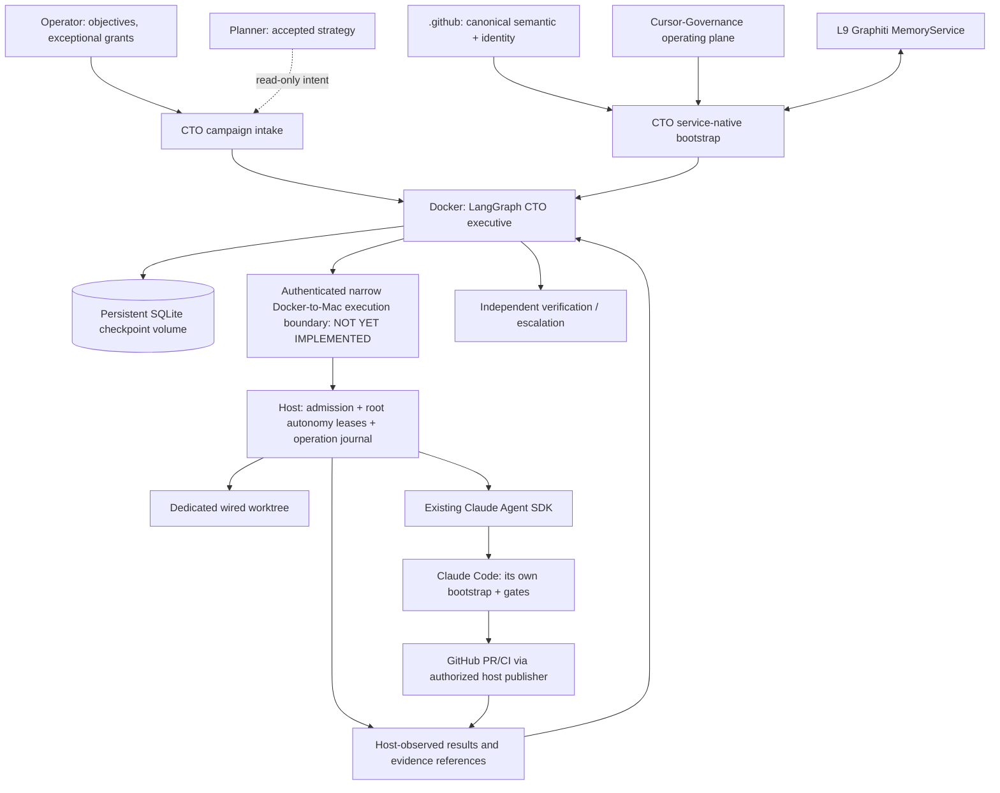
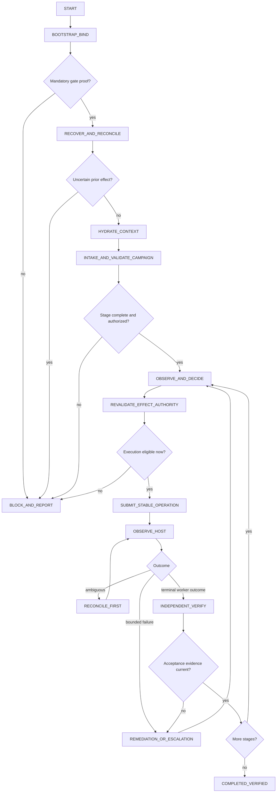

# 02 | Complete target system architecture and ownership

## 2.1 Logical and physical tiers



**Physical boundary 1: Docker executive.** Runs CTO Python/LangGraph; uses a restricted mounted checkpoint volume and strictly scoped, independently authenticated external calls. No Docker daemon socket, Mac home, grant issuer account, repo-write mount, operator credential or Claude worker secret in the container.

**Physical boundary 2: Mac worker host.** Owns code checkout, the actual Claude SDK process, target worktrees, permissions/hooks, GitHub credentials and journal of external operations. CTO requests are untrusted until host verifies them independently. The host does not infer authority from model-authored prose or an arbitrary env var.

**Physical boundary 3: Canonical and memory upstream.** `.github` defines semantics and admits identity; Cursor-Governance consumes canonical projections and owns execution governance; MemoryService enforces memory principal/namespace grants.

## 2.2 Actor identity, runtime identity and trust model

ProductIdentity (if applicable), ReleaseIdentity, RuntimeIdentity, ActorIdentity and SurfaceIdentity are separate canonical dimensions. Distinct adapter/provider identifiers and governance profiles are not identities. CTO's actor/surface are unresolved in the current upstream registers. CTO may not borrow `cursor`, `claude-code`, `human` or merely set `L9_MEMORY_AGENT_ID=l-cto` to assert itself.

**Delegation is separate from identity.** A valid CTO actor assertion tells the host *who* requests a task, not *whether* that actor may modify the named target, execute this worker, create a PR or merge anything. Proof must be scoped to operation, repository, revision, restrictions, grant issuer, expiry and effect class.

## 2.3 Executive responsibilities

- Accept campaigns and reject incomplete/ambiguous ones without inventing requirements.
- Observe actual current state from the relevant owner. Fresh source SHA and target HEAD matter.
- Choose next authorized stage based on predecessor evidence and actual delegated permissions.
- Supply the native coding execution contract and worker inputs without mutating its locked schema.
- Supervise one worker, manage lease lifecycle and inspect host truth. Remote worker success is never promoted directly into verified business outcome.
- Drive bounded same-scope remediation on evidence-backed failure; preserve unrecoverable and unauthorized outcomes as escalation.
- Keep operational continuity in LangGraph; store relevant durable knowledge in MemoryService under actual principal grants, not in checkpoint as global fact.
- Report operator-facing `READY_FOR_READ`, `EXECUTION_BLOCKED`, `EXECUTION_ELIGIBLE`, `RUNNING`, `VERIFY_PENDING`, `MERGE_PENDING`, `COMPLETED_VERIFIED` as *explanatory presentation labels*; do not claim these are new globally admitted L9 enum values.

## 2.4 Ownership and single-writer matrix

| Concern | Authoritative owner | CTO operation | Must not do |
|---|---|---|---|
| Global identity and invariants | `.github` canonical source + qualified admission producer | Consume exact verified projection/assertion | Edit/locally shadow law |
| Strategy and objectives | Planner / operator | Consume accepted priorities | Change strategic plan |
| Architecture | GAR / proper semantic authority | Consume frozen architecture, raise contradictions | Reopen freeze in coding stage |
| Campaign coordination | CTO | Operate one active campaign | Concurrent duplicate commander |
| Global action leases and claims | Root `autonomy/` | Request, verify, reconcile | Second leases DB or arbitrary claim generator |
| Worker runtime | Claude SDK/host + Claude Code adapter | Delegate bounded task, observe | Duplicate code execution engine |
| Worker governance | Project `CLAUDE.md` / `.claude/settings.json` / actual hooks | Require correct project bootstrap and installed SDK | Inject shadow allowlists/hook policy |
| Git worktrees and publication | Existing host scripts, existing `make pr` | Call only through authorized host boundaries | Raw push bypass, parallel publisher |
| Merge grants | Human + existing merge gate | Report pending exact target | Mint or forge grant, auto-merge |
| Memory | MemoryService | Context, scoped durable lessons | Store shared facts without authorization |
| Workflow continuation | LangGraph checkpoint | Resume same campaign thread | Treat checkpoint as effect journal |
| External effect truth | Host journal, GitHub, CI, independent assessor | Observe and reconcile | Trust worker prose |
| Secrets | Existing host/Infisical and effect-owner setup | Reference permitted capabilities | Copy credentials into container/prompt |

## 2.5 Workflow graph and edges



Each decision node consumes typed evidence and returns state updates. Graph builder does not compile; executor alone binds the existing durable checkpointer. One stable `thread_id` per campaign. Recovery uses `invoke(None, config)` rather than replaying a fresh start for an already checkpointed thread.

## 2.6 Command and data interfaces (conceptual, not new APIs)

**Inbound:** operator objective, campaign pack reference plus exact SHA/digest, frozen acceptance criteria, explicit permit/grant references, target repository/ref, allowed read/write scope, forbidden actions, explicit resource ceilings.

**Internal:** immutable canonical binding and provenance, bounded campaign state, one or more read-only observations, next-action decision, operation ID/fingerprint, pending verification and risk register.

**Host egress:** `submit(operation)`, `observe(operation_id)`, optionally authorized `cancel(operation_id)`; details must bind to existing owner contracts and are not presented as a new canonical L9 schema.

**Memory:** existing read, hydrate, scoped write, governed write/phase-lock and close through admitted principals; not a worker effect journal.

**Evidence:** host observation, exact worker process metadata, artifact digest/target HEAD, current CI/review receipts, independent acceptance when required. Evidence is append-only by logical identity; corrections do not erase prior contradictory observations.

## 2.7 Deployment topology and failure domains

Docker restart should preserve persisted `.l9/langgraph` checkpoint files and restore *ongoing* campaign identity. Container loss cannot kill a host worker's independent truth; on resume CTO must query host first. Mac shutdown may stop both; on reboot replay begins from host operation journal and GitHub truth, not client retries. Unavailable upstream identity/projections stops effect admission; unavailable memory blocks campaigns only when that operation requires context or a governed memory write. Network split produces `UNKNOWN`, never inferred effect failure.

## 2.8 Initial vs later capabilities

**Initial:** local Docker, one executive, one campaign, one worker, read-only canary then one fully governed code task, SQLite checkpoint, private/shared memory if independently bound, explicit status output.

**Later after independent proof:** parallel claims, multiple worker roles, hosted availability, richer ingress, reasoning-model provider optimization, remote observer enhancements, performance dashboards, additional memory semantics only from proper owners.

## v1.1 | Selected execution plane and owner chain

```text
Quantum-L9/.github [canonical identity and law; no effect grants]
    |  existing l9-authority-resolver, verified immutable authority resolution
    v
Cursor-Governance CTO / LangGraph [executive coordinator only]
    | asks existing root AutonomyRuntime/AdapterOrchestrator for lease + permission
    v
Cursor-Governance root Autonomy [campaign, action, claims, capability, receipts]
    | independently verifiable action/grant; NO raw shell
    v
AgentPod Hub [scoped agent principal + MCP: transport/access broker]
    | outbound WSS, enrolled APN macOS node
    v
Host-side L9 effect gate [must recheck exact operation and current grant]
    | read-only or granted isolated worktree, durable op record
    +--> Cursor CLI via ACP [needs AgentPod descriptor and current hooks proof]
    `--> Claude Code AgentPod station [supported descriptor, L9 hook parity unproved]
    | effect observation + independent evidence
    v
Root receipts/checkpoints [reconciliation and acceptance, no self-certification]
```

**No new repository.** AgentPod's own upstream project remains an externally owned dependency; a needed Cursor descriptor change requires separate upstream authority and write grant. AgentPod's role is **transport/runtime management only**, not a replacement for L9's semantic law, permission decisions, separate worker role, native code contract, or protected publication. CTO LangGraph checkpoints record executive state, not remote operation completion. No direct relationship exists between AgentPod `apn` machine enrollment and CTO actor admission.
