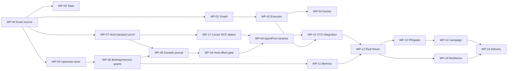

# 08 | Granular implementation work breakdown and dependency program

## 8.1 Work program principles

- **Source-bound:** Every work package starts by checking actual current source revision and reading all modified owners.
- **Bounded mutation:** The initial implementation writable repo is `Quantum-L9/Cursor-Governance` only, on a dedicated isolated worktree and explicit branch. `.github` and `l9-graphiti-memory` are read-only. Upstream admission is a distinct authorized campaign, not a hidden expansion.
- **Upstream first when necessary:** Resolve actor/surface/permission semantics at canonical owner before activating real host execution; do not block mock CTO on an unissued real grant.
- **Max useful concurrency:** Work on independent source-owner proofs/test fixtures in parallel; serialize code edits that touch shared files or require a predecessor's exact API.
- **One publisher:** Use existing validated repo publication path once per PR; never duplicate full publish ceremony or assume a Make target without reading its current owner.
- **No test theatre:** Every PASS must have exact commit/env/test receipt; source review alone is not a passed test.

## 8.2 Phase gates

| Phase | Work | Exit evidence | Real execution permitted? |
|---|---|---|---|
| F0 | Freeze design+recon+filetree+readiness objectives (this pack) | Reviewed design, pinned source links, explicit missing host/authority seams | No |
| F1 | Runnable mock-only CTO StateGraph and Docker checkpoint continuity | Deterministic tests: no mutation, stable thread, lost ACK, source/identity-blocked | No |
| F2 | Upstream identity/operating admission through owner-approved separate change | Canonical actor/surface/identity resolution; current verified projection and active scoped grants | Not by itself |
| F3 | Trusted Mac host worker interface and per-operation journal | Authenticated canary, revoke-deny, no duplicate spawn, host account separation | Read-only canary initially |
| F4 | Governed end-to-end coding + memory + independent verification | One real bounded code task, signed memory principal, exact effect evidence, no false green | Scoped real execution |
| F5 | Branch Consolidation campaign integration + interruption acceptance | Fully supplied native contracts; reference campaign completed with actual receipts | Only authorized actions |
| F6 | Operational promotion and routine operation | Real reboot restore, backup/restore, negative security, operational handoff | Proven delegated scope only |

## 8.3 Detailed work packages

**WP-00 Evidence refresh (F0 prerequisite).** Inputs: exact source baselines and user-accepted filetree. Read current `.github` and Cursor-Governance main heads and active PRs; record delta to frozen design; inspect owner files. Output: source census and changed-risk log. PASS: every read/write path and current source owner is exact, no substituted archive path. FAIL: missing source or stale/ambiguous owner. Does not mutate.

**WP-01 Mock graph domain (F1).** Implement CTO state routing in `workflows/dags/cto/graph.py` using existing LangGraph. Define exact graph nodes for intake→bind→recover→observe→validate→submit mock→reconcile→verify→checkpoint/complete, with explicit blocked/unknown paths. Owner must keep graph builder side-effect free, one thread/campaign. PASS: graph validator and route negative tests; no duplicate runtime or scheduler. Depends WP-00.

**WP-02 Mock executor/service bootstrap (F1).** Implement in `executor.py` using `open_checkpointer` and source-bound reader interfaces. No actual SDK process from Docker. Inject fake host and fake memory, immutable operation IDs. Basic status/readiness CLI should never grant authority. PASS: no READY on Docker startup, current thread restore, no mutation method reachable without real port. Depends WP-01 or agreed function seam; may develop mock adapters independently in tests.

**WP-03 Domain negative tests (F1).** Add `tests/workflows/test_cto_runtime.py`; fault matrix: absent actor, stale grant, tampered contract, changed SHA, missing worker, failed context, lost ACK, conflicting op ID, restart. For every security gate create known-good and known-bad cases. PASS: tests fail with intentionally disabled checks and pass with code. Can start in parallel with WP-01 after test/graph interface is frozen; test changes on separate branch to avoid collision.

**WP-04 Docker packaging (F1).** Build `ops/cto/Dockerfile` and `compose.yaml` from existing Python lock; no secrets/host sockets. Named checkpoint volume; read-only container where possible; no worker SDK or host credentials in image. PASS: image starts mock executive, restarts preserving checkpoint, inspection shows absent forbidden mounts. Parallel with WP-03; integrate after WP-02.

**WP-05 Canonical identity admission proof (F2).** Read upstream registries, projection producer obligations and semantic owner. Determine whether CTO actor/surface require new admitted canonical meaning; if so, draft **separate upstream change request**, no downstream backpatch. PASS: exact admitted actor/surface and identity assertion verified by qualified upstream/producer and applicable receipts. Target `.github` write requires separate explicit grant. Parallel to F1, but blocks F3 real effect.

**WP-06 Operating delegation and memory principal (F2).** After WP-05, resolve `agent_registry.yaml`, existing `PEER_RUNTIME_BINDINGS.yaml` role semantics, per-principal signed memory assertion and permitted namespaces. Do not give CTO a standing human role or wildcard execution scope. PASS: valid CTO-scoped principal, denied unauthorized namespaces, host actor evidence independent of `L9_MEMORY_AGENT_ID`. May perform read-only design in parallel with WP-05; no binding activation before upstream admission.

**WP-07 AgentPod MCP/APN transport and Cursor ACP fit (F3 design).** Technology is LOCKED to AgentPod. Read AgentPod Hub MCP principal/grants, rootless APN host, current descriptor registry and Cursor `agent acp` API, plus CG root autonomy APIs; determine exact security-compatible route without arbitrary terminal/fs.write. PASS: source-bound adapter/protocol map and explicit negative-probe contract. If no lawful fit, BLOCK relevant host lane; do not silently revert to generic localhost server. Depends WP-00; read-only work can parallel F1.

**WP-08 Root Autonomy mediated host journal and operation binding (F3).** Reuse `AutonomyRuntime`, leases, claims, `CapabilityGateway`, receipt chain and proven existing store owner. Bind immutable operation ID, native contract digest, target SHA, worker identity, AgentPod station and current authorization to durable host acceptance before spawn. Duplicate same ID same digest is observe-only; different digest denies. PASS: no duplicate external effect and exact host observation after reconnect. Depends WP-07/WP-06 for real auth; mock journal proof may start earlier.

**WP-09 Real AgentPod station canaries and worker isolation (F3).** Test Claude Code through existing AgentPod descriptor with L9 native-contract/project-hook parity; test Cursor through newly accepted ACP descriptor/compatible mediated harness. Reuse native SDK only where its established responsibilities remain necessary, not as a competing default host transport. Both canaries run in separate worker UID/worktree; APN terminal and unmediated file writes remain denied. PASS: observed process/session, host reauthorization, no human grant access, accurate terminal/effect records. Depends WP-08 plus WP-17/WP-18 and host installation proof.

**WP-10 CTO → AgentPod MCP integration (F3).** Add only smallest verified L9-side adapter consumption in existing autonomy ownership. Recheck action-specific root lease and host-side enforcement; do not call general AgentPod terminal as escape. Map *logical* submit/observe/cancel to actual provider protocol and use observe-first on outstanding IDs. PASS: lost ACK/reconnect no duplicate spawn, revoked/mismatched grants deny, host failure is safe UNKNOWN. Depends WP-08/09/18; stacked PR only where required.

**WP-11 Memory integration (F4).** Consume installed MemoryService v2.6.0 through existing runtime binding. Run under CTO signed principal, real namespace-grant negative tests, bounded read/write/close and shared promotion rights. PASS: authorized private read/write and properly denied peer-private; real facts only after acceptance. Depends WP-06; can develop fake-memory route early, real proof later.

**WP-12 Real bounded coding acceptance (F4).** Use controlled fixture repo/worktree, valid delegation and exact native contract. Worker performs allowed limited change, host records effect; independent test and Git evidence validate. Corrupt/denied cases must fail at actual host gate. No uncontrolled production target. Depends WP-09/10 and required WP-11 if task uses memory.

**WP-13 Publication and merge boundary proof (F4).** Validate exact existing `make pr` owner and worktree ceremony; one authorized test PR with real current SHA/CI receipt, then stop MERGE_PENDING without human grant. PASS: no auto-merge; unauthorized attempt blocked; raw bypass has no privileged token. Depends WP-12; may be deferred if reference demonstration permits a no-publish code effect stage.

**WP-14 Reference Branch Consolidation completion (F5).** Obtain all referenced native contract directories, freeze scope, validate stages 0–5 and owner refs, run one-worker-first supervision, then adapt only if acceptance requires parallel workers and parallel support has been proven separately. PASS: exact published/merged/hosted evidence as relevant and authorized; no worker-prose closure. Depends WP-12/13, external source pack and independently approved grants.

**WP-15 Operational hardening (F6).** Mac reboot recovery, backup restore, corrupt checkpoint, stale credential revocation, resource ceilings, sensorless uptime, actionable operator status, parallel commander fencing, rollback drills, independent review receipts. PASS: success from fresh Mac/container deployment; all negative tests with exact logs. Depends F4 live proof; reference campaign strengthens but not required for basic resilience proof.

**WP-17 Cursor ACP AgentPod station support (F3 separate upstream owner).** AgentPod currently does **not** register a Cursor descriptor. Prove existing descriptor infrastructure can implement Cursor CLI `agent acp` without escalating host tools or bypassing L9. If upstream implementation is required, obtain a **separate explicit AgentPod repository write grant** and provider review; otherwise use only an existing supported mediated adapter with full evidence. PASS: Cursor station discoverable, no arbitrary terminal path, proper ACP session/permission/cancel and project rules evidence. Depends WP-07; may proceed alongside WP-08, but must complete before Cursor canary.

**WP-18 APN host-side root authorization enforcement (F3).** Implement only minimum code justified by the existing L9 owner and AgentPod provider seam. Host independently validates CTO actor assertion, action-specific worker lease, campaign scope, exact repo/base/path, current grant, native contract fingerprint, expected worker station and op id before every consequential effect. Deny generic AgentPod terminal/fs-write bypass at provider scope. PASS: injection, cross-agent replay, expired/revoked lease, token confusion and OS merge-grant access all fail **at host**, not merely CTO client. Depends WP-06 and WP-08; may run in parallel with WP-17 if write sets are disjoint.

**WP-16 Cleanup and delivery (F6).** Inspect no unused CTO helpers, no PE dependencies, no new owner duplication, update applicable existing documentation/index/projection via owner (do not hand-edit `filetree.md`). Deliver exact commit/PR, tests, evidence, escalation runbook, architecture fidelity and known constraints. Depends WP-15.

## 8.4 Dependency DAG and concurrency

**Parallel read-only lanes from WP-00:** F1 prototype, upstream identity resolution, AgentPod/ACP protocol fit. WP-17 provider/descriptor proof can proceed alongside WP-08 root journal and WP-18 host enforcement once interfaces are fixed; write permissions for AgentPod remain separately required. **Parallel code lanes after function shape:** CTO test author and Docker packaging may run concurrently in disjoint files; integrate once into one verified baseline. **Sequential hard edges:** host journal before real spawn, canonical identity/delegation before live effect, effect reconciliation before acceptance, independent result before promotion. No deliberate `merge` step is required merely because two PRs exist; stack related PR heads and base unrelated work at applicable `main`, follow actual merge-only admission dependencies.

## 8.5 PR boundaries (proposed, not authorized)

- PR-A: mock-only CTO graph/executor/domain tests and Docker. No host access, no memory write, no publication outside governance ceremony.
- PR-B: upstream canonical identity/surface admission, owned separately in `.github` by explicitly authorized actor. Not an automatic child of PR-A unless dependency requires it.
- PR-C: CG existing Autonomy adapter/journal/host re-enforcement against AgentPod, **only** after exact provider API and proper scoped grant; stack downstream consumers on exact head.
- PR-C2 (conditional): AgentPod upstream Cursor ACP descriptor owned by AgentPod maintainers and separate authorization; never bundle into CG PR-C.
- PR-D: CTO real host integration, CTO memory client binding and end-to-end tests after admitted identities; scope only changed owner files.
- PR-E: reference campaign hardening, operational protection, readiness proof after real function.

Do not fabricate exact branch names or PR numbers at planning time; resolve from actual repository state and coding contracts. Commit/release/merge grants remain distinct from PR visibility.

## 8.6 Quality gate at every work package

Entry: frozen objective, exact source owner/head, read/write permissions, relevant predecessor evidence, known failure vectors, target isolation. Exit: reproducible tests, actual scope diff, no owner law drift, honest status, independent validation when material, evidence mapping and next work's exact SHA. Failed validation invalidates the affected WP outcome; do not carry it forward as pass.
